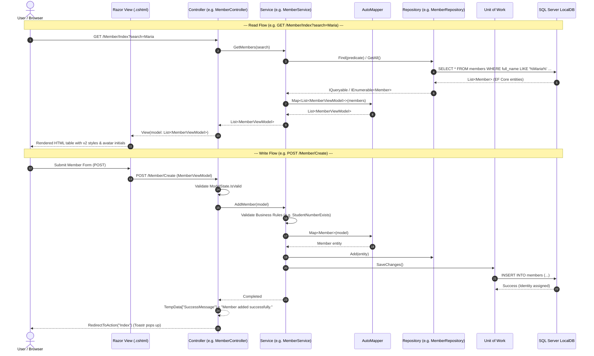

# AttendTa — Architecture, Data Flow & Frontend Integration Reference

This document provides a complete overview of the current workspace architecture (`f:\AttendTaBakcend\AttendTa`), detailing the **4-layer Clean Code structure**, the **end-to-end flow of data**, and the exact changes introduced during the **AttendTa v2 frontend integration**.

---

## 1. High-Level Architectural Structure

The backend follows an **N-Layer Clean / Onion Architecture** with strict layer separation:

```
┌────────────────────────────────────────────────────────────────────────┐
│  4. WebApp Layer (ASI.Basecode.WebApp)                                 │
│     • Controllers: ControllerBase<T>                                  │
│     • Presentation Views: Razor (.cshtml) + Toastr                    │
│     • Static Assets (wwwroot): tokens.css, components.css, icons.svg   │
│     • Composition Root: Startup.DI.cs, Startup.AutoMapper.cs          │
└───────────────────────────────────┬────────────────────────────────────┘
                                    │ consumes ViewModels & Service Interfaces
┌───────────────────────────────────▼────────────────────────────────────┐
│  3. Business / Services Layer (ASI.Basecode.Services)                  │
│     • Service Contracts: IMemberService, IVenueService, etc.           │
│     • Implementations: MemberService, VenueService, EventTypeService   │
│     • ViewModels / DTOs: MemberViewModel, VenueViewModel, etc.        │
│     • Validation rules: DataAnnotations & business exception checks   │
└───────────────────────────────────┬────────────────────────────────────┘
                                    │ consumes Entities & Repo Interfaces
┌───────────────────────────────────▼────────────────────────────────────┐
│  2. Data Access Layer (ASI.Basecode.Data)                              │
│     • DbContext: AsiBasecodeDBContext (EF Core 9)                      │
│     • Entities: Member, Venue, EventType, User                         │
│     • Repositories: MemberRepository, VenueRepository, EventTypeRepo   │
│     • Base Patterns: BaseRepository<T>, UnitOfWork                     │
└───────────────────────────────────┬────────────────────────────────────┘
                                    │ references constants & messages
┌───────────────────────────────────▼────────────────────────────────────┐
│  1. Resources Layer (ASI.Basecode.Resources)                           │
│     • Localized Messages: Messages.resx                                │
│     • Constants & Enums                                                │
└────────────────────────────────────────────────────────────────────────┘
```

---

## 2. End-to-End Flow of Data

The data flow remains **strictly inward and outward through designated contracts**:



---

## 3. What Was Changed & Impact on Data Flow

> [!IMPORTANT]
> **Key Finding on Data Flow:**
> **No changes were made to the core data flow, service interfaces, or database contracts.**
> The Clean Architecture boundaries were strictly preserved. All adjustments were confined to the **Presentation Layer (Outer Shell)** to format and display data using the AttendTa v2 design system.

### Detailed Component Comparison:

| Layer / Component | Before Integration | After Integration | Data Flow Impact |
|---|---|---|---|
| **Database Schema** | `members`, `venues`, `event_types`, `Users` tables in `AsiBasecodeDB`. | **Identical.** Zero column additions or migrations. | **None.** Data shape in DB is 100% unchanged. |
| **Data Entities (`ASI.Basecode.Data.Models`)** | Plain EF Core entities (`Member`, `Venue`, `EventType`). | **Identical.** Untouched. | **None.** |
| **Repositories (`ASI.Basecode.Data.Repositories`)** | Queries using EF Core with `UnitOfWork.SaveChanges()`. | **Identical.** Untouched. | **None.** |
| **Services (`ASI.Basecode.Services.Services`)** | `MemberService`, `VenueService`, `EventTypeService` validation & mapping. | **Identical.** Untouched. | **None.** |
| **ViewModels (`ServiceModels`)** | `MemberViewModel`, `VenueViewModel`, `EventTypeViewModel`. | **Identical.** Untouched. | **None.** Data transfer objects remain the exact same contract. |
| **Controllers (`ASI.Basecode.WebApp.Controllers`)** | `MemberController`, `VenueController`, `EventTypeController`. | **Identical.** Endpoints, actions, and TempData flash messaging untouched. | **None.** Controller actions receive and return the exact same models. |
| **Views / UI (`Views/`)** | Legacy Bootstrap 5 tables and basic HTML form inputs. | **Upgraded 1:1 to AttendTa v2**: Modern tables, `.status-pill`, avatar initials, card forms, and Outfit typography. | **Presentation-only formatting:** Visual presentation of ViewModel properties was updated. |
| **Layout Shell (`_Layout.cshtml`)** | Generic Bootstrap top navbar. | **AttendTa v2 Officer Sidebar**: Fixed left navigation drawer on $\ge$1024px, grouped sections, top bar breadcrumbs, role chip, and Toastr bridge. | **Presentation-only.** |
| **Assets (`wwwroot/`)** | Basic Bootstrap CSS/JS. | Added `tokens.css`, `components.css`, `icons.svg`, `attendTa_logo.jpg`, and Tailwind engine. | **Static assets only.** |

---

## 4. Presentation-Level Data Helpers (Reconciled Fields)

To match the v2 prototype without modifying the backend database, presentation-only helpers were incorporated directly inside the Razor views:

1. **Avatar Initials (`Views/Member/Index.cshtml`)**:
   - *Logic:* `FullName.Split(' ')` extracts the first letter of the first and last name (e.g. `"Maria Clara C. Santos"` ➔ `"MS"`).
   - *Data Flow:* Purely visual; no database column needed.
2. **Event Type Accent System (`Views/EventType/Index.cshtml`)**:
   - *Logic:* Razor helper maps `TypeName` to calibrated CSS variables (`--event-indigo`, `--event-teal`, `--event-amber`, etc.).
   - *Data Flow:* Maps existing string property to v2 color dots and badges without storing UI colors in the DB.
3. **Status Badging (`Views/Member/Index.cshtml`)**:
   - *Logic:* Binds `member.Status` directly to `<span class="status-pill" data-status="@member.Status">`.
   - *Data Flow:* Uses existing `Status` column (`active`/`inactive`) and triggers the existing `ToggleStatus` POST action.
4. **Flash Messaging (`Views/Shared/_Layout.cshtml`)**:
   - *Logic:* Reads `TempData["SuccessMessage"]` and `TempData["ErrorMessage"]` emitted by controllers and feeds them into Toastr alerts.

---

## 5. File Inventory of Changes

```
f:\AttendTaBakcend\AttendTa\
├── ASI.Basecode.WebApp\
│   ├── wwwroot\
│   │   ├── css\
│   │   │   ├── tokens.css               [NEW - Imported from v2/assets]
│   │   │   └── components.css           [NEW - Imported from v2/assets]
│   │   ├── images\
│   │   │   ├── icons.svg                [NEW - SVG sprite imported from v2/assets]
│   │   │   └── attendTa_logo.jpg        [NEW - Branding logo]
│   │   └── js\
│   │       ├── tailwind.config.js       [NEW - Theme & token mapping]
│   │       └── app.js                   [NEW - v2 client utilities]
│   └── Views\
│       ├── Shared\
│       │   └── _Layout.cshtml           [MODIFIED - Converted to v2 Officer Sidebar Shell]
│       ├── Member\
│       │   ├── Index.cshtml             [MODIFIED - 1:1 v2 Members Ledger & Search]
│       │   ├── Create.cshtml            [MODIFIED - v2 Form layout]
│       │   ├── Edit.cshtml              [MODIFIED - v2 Form layout]
│       │   └── _Form.cshtml             [MODIFIED - v2 inputs & validation styling]
│       ├── Venue\
│       │   ├── Index.cshtml             [MODIFIED - 1:1 v2 Venues Ledger]
│       │   ├── Create.cshtml            [MODIFIED - v2 Form layout]
│       │   ├── Edit.cshtml              [MODIFIED - v2 Form layout]
│       │   └── _Form.cshtml             [MODIFIED - v2 inputs & validation styling]
│       ├── EventType\
│       │   ├── Index.cshtml             [MODIFIED - 1:1 v2 Event Types Ledger with Accents]
│       │   ├── Create.cshtml            [MODIFIED - v2 Form layout]
│       │   ├── Edit.cshtml              [MODIFIED - v2 Form layout]
│       │   └── _Form.cshtml             [MODIFIED - v2 inputs & validation styling]
│       └── Account\
│           └── Login.cshtml             [MODIFIED - 1:1 v2 Institutional Auth Card]
└── ARCHITECTURE_DATA_FLOW.md            [NEW - This documentation file]
```

---

## 6. How to Run & Verify

1. **Build the Solution** (using .NET 10 SDK with .NET 9 roll-forward):
   ```powershell
   $env:DOTNET_ROLL_FORWARD = "LatestMajor"
   & "C:\Program Files\dotnet\dotnet.exe" build "f:\AttendTaBakcend\AttendTa\ASI.Basecode.sln"
   ```
2. **Start the Web Application**:
   ```powershell
   $env:DOTNET_ROLL_FORWARD = "LatestMajor"
   & "C:\Program Files\dotnet\dotnet.exe" run --project "f:\AttendTaBakcend\AttendTa\ASI.Basecode.WebApp\ASI.Basecode.WebApp.csproj"
   ```
3. Open `http://localhost:5000/Account/Login` to view the authenticated application.
