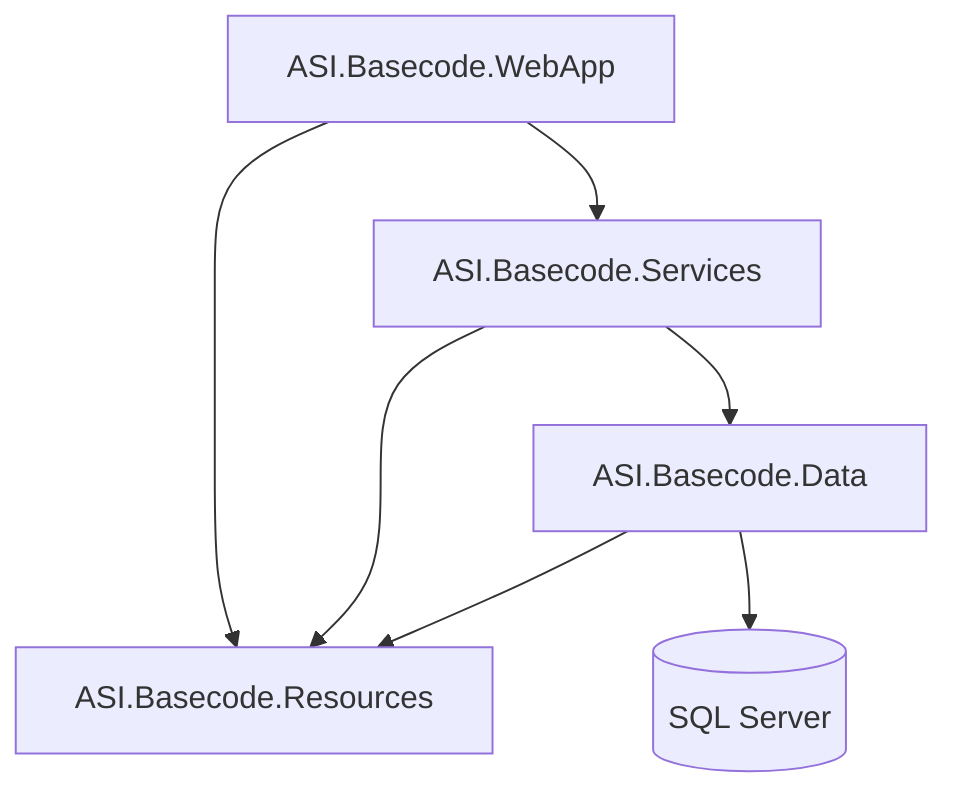
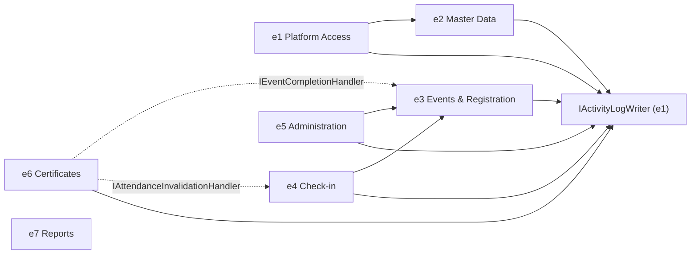
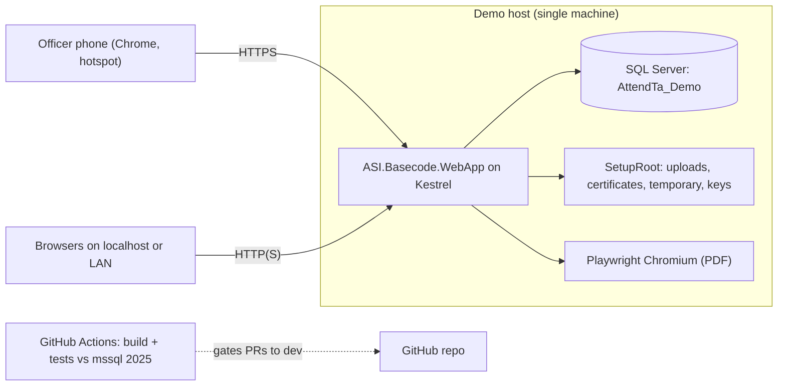
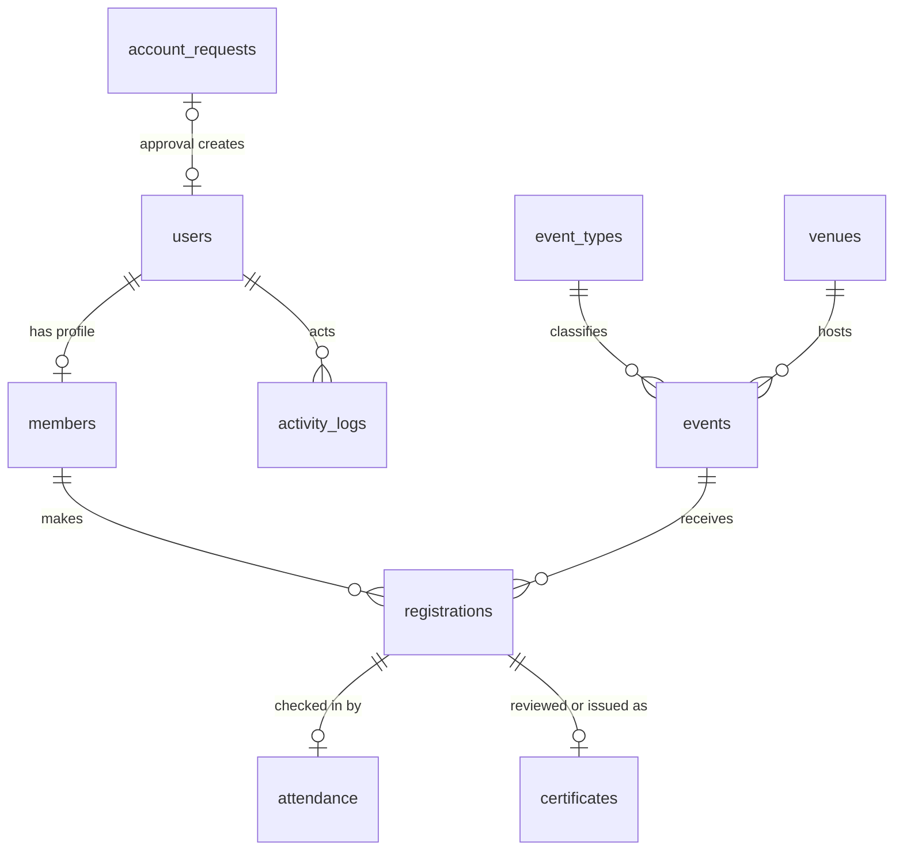

# Architecture Spine — AttendTa

## Design Paradigm

A **layered MVC monolith**. Each use case is a **transaction-script** method on a Services-layer service. Each layer depends only on the layer below it. Resources is a leaf that every layer may read.

| Layer | Project | Holds |
| --- | --- | --- |
| Web | `ASI.Basecode.WebApp` | Controllers, Razor views, cookie auth, `ICurrentActor` adapter, file-store, PDF and QR adapters, compiled Tailwind |
| Application | `ASI.Basecode.Services` | Use-case services, `DomainException`, view models, paging types, hook and collaborator interfaces |
| Data | `ASI.Basecode.Data` | `AsiBasecodeDbContext` (fluent mapping), entities, lookup enums, repositories, `UnitOfWork`, `ParticipationFacts`, `ActivityLogWriter` |
| Shared | `ASI.Basecode.Resources` | Role codes, `AuditActions`, messages |



The module graph below shows only service-level calls and hook implementations. A solid arrow means "calls the target's service". A dotted arrow means "implements a hook interface the target declares". Cross-module reads go through Data-layer read queries and are not drawn.



## Invariants & Rules

### AD-1 — Layered monolith [ADOPTED]

- **Binds:** all
- **Prevents:** a second application or domain project, and controllers that reach repositories or `DbContext` directly.
- **Rule:** Dependencies run only WebApp → Services → Data, plus Resources. Controllers call Services only. Data never references Services types. The only new projects allowed are the two test projects in AD-17.

### AD-2 — One writer per table, hooks across modules

- **Binds:** all epics; R2, R5, R7, R13, R20, R22, R25, R32
- **Prevents:** two modules writing the same entity under different rules, dependency cycles between modules, and an epic blocked by a later epic.
- **Rule:**
  - Each table has one repository class in Data. Only the module listed below may call write methods for its table or columns, and only from its own service.
  - A module **reads** another module's tables only through Data-layer read queries or `ParticipationFacts`. For example, e2 checks the participant limits of linked events this way.
  - A module **writes** another module's data only by calling the owner's service, or by implementing a hook the owner declares.

| Table / columns | Writer (epic) |
| --- | --- |
| `account_requests`; `users` create and `password_hash` | Platform Access (e1) |
| `users.full_name` | Master Data (e2) |
| `users.role_id`, `users.is_active` | Administration (e5) |
| `members` create, through the existing `MemberService.CreateMemberFromApprovedAccountRequest` called by e1's approval; all profile fields | Master Data (e2) |
| `members.membership_status_id` | Administration (e5) |
| `event_types`, `venues` | Master Data (e2) |
| `events`, including `is_check_in_open` and its actor columns | Events & Registration (e3) |
| `registrations` | Events & Registration (e3) |
| `attendance` | Check-in (e4) |
| `certificates` | Certificates (e6) |
| `activity_logs` | Any module, only through `IActivityLogWriter` |

Cross-module writes:
- **Check-in toggle (R22).** e4 owns the command and its rules. It sets the flag through `IEventLifecycleService.SetCheckInWindowAsync`, which e4 adds to e3's service with e3's review. Cancel and complete clear the flag in their own row update.
- **Hooks.** The module that owns a transaction declares the hook interface in Services and calls every registered implementation (`IEnumerable<T>`) inside that transaction. Before an implementation exists, the list is empty. That is correct behavior, not a stub: no certificate rows can exist before e6 lands.

  | Hook | Declared by | Implemented by | Effect |
  | --- | --- | --- | --- |
  | `IEventCompletionHandler` | e3 completion (R13) | e6 | Creates a Certificate Review for each Registration with Valid Attendance |
  | `IAttendanceInvalidationHandler` | e4 invalidation (R25) | e6 | Throws `Forbidden` if the Certificate is issued; otherwise sets an unissued review to `not_eligible` with the reason |

### AD-3 — Caller-owned unit of work

- **Binds:** every mutating use case; NFR-2; R2, R12, R13, R16–R18, R23, R25, R27, R28, R32, R33
- **Prevents:** half-committed multi-record changes, audit rows committed apart from their change, and conflicting retry behavior.
- **Rule:** Each mutating use case runs inside `IUnitOfWork.ExecuteInTransactionAsync(work, ct)` (overloads: `Task` and `Task<T>`).
  - The call opens one transaction on the request-scoped `DbContext` and commits it after `work` returns. On an exception it rolls back, calls `ChangeTracker.Clear()` and rethrows.
  - Inside `work`, code may call `SaveChangesAsync` as often as it needs to obtain identity keys. Only the outermost scope commits.
  - A nested call joins the open transaction.
  - Hooks, `IRegistrationCancellationService` and `IActivityLogWriter` throw if no transaction is open.
  - Repositories never call `SaveChanges` and never open transactions.
  - No `EnableRetryOnFailure` and no execution strategy.
  - The database runs with `READ_COMMITTED_SNAPSHOT ON`. Guard rechecks read only rows protected by locks the transaction already holds.
  - **Migration:** e1 moves the master-data repositories off per-write `SaveChanges`. It converts their mutating methods to async and wraps `EventTypeService`, `VenueService` and `MemberService` writes in `ExecuteInTransactionAsync`.

### AD-4 — Lock order and serialization

- **Binds:** R2, R5, R7, R9–R18, R22–R25, R27, R28, R31, R32; SM-4
- **Prevents:** deadlocks from inconsistent lock orders, overbooking, a capacity or master record that changes under a publish, duplicate attendance or issuance, and removing the last administrator.
- **Rule:**
  - Competing writes serialize on row locks taken through repository `Lock…Async(id)` methods. Each runs `SELECT … WITH (UPDLOCK, HOLDLOCK, ROWLOCK)` as a primary-key seek, never a range or non-key predicate.
  - Locks are taken only in this order:
    1. App lock `attendta:last-admin`, taken through `sp_getapplock` (Exclusive, owner = Transaction, bounded `@LockTimeout`; a negative return throws `Stale`). Taken only by role or access changes that could remove an active administrator.
    2. `account_requests`.
    3. `users`, ascending id. This lock also protects the user's `members` row.
    4. `event_types`.
    5. `venues`.
    6. `events`, ascending id.
    7. `registrations`, `attendance`, `certificates`.
  - Rows in `registrations`, `attendance` and `certificates` are written only while holding their event's lock.

  | Operation | Locks, in order |
  | --- | --- |
  | Signup, approve, decline, promote, member or admin cancel, check-in, attendance invalidation, eligibility decision, issuance | Owner's `users` row → event |
  | Event create, edit, publish | Event type → venue → event |
  | Event cancel, complete, check-in toggle | Event |
  | Venue capacity edit; venue or type deactivation | Venue or type row, then read linked events |
  | Member profile, membership status, role or access change | `users` row (plus the app lock where step 1 applies) |
  | Deactivation that cancels registrations (R32) | `users` row → affected events, ascending |

  - Queue selection follows discover → lock → recheck. If the recheck finds a different candidate or priority, roll back and throw `Stale`.
  - No process-local locks. After a timeout with an unknown commit result, re-read the state instead of retrying blindly.
  - Rendering and file I/O never run while holding a lock.

### AD-5 — Canonical participation facts

- **Binds:** R10, R12–R19, R23–R27, R30, R32
- **Prevents:** modules that disagree on eligibility, attendance validity, cutoffs or report formulas.
- **Rule:** `ASI.Basecode.Data/Queries/ParticipationFacts.cs` holds one expression or query per fact. Every module uses it and none re-derives a fact. e3 creates the file; e4 owns Valid Attendance.

| Fact | Definition |
| --- | --- |
| Eligible Participant | `users.is_active` and `members.membership_status_id` = Active |
| Valid Attendance | `attendance` row exists and `invalidated_at IS NULL` |
| Seat held | registration status = Confirmed |
| Waitlist priority | `reviewed_at ASC, registration_id ASC` across all Waitlisted rows of the event |
| Event Start Cutoff passed | now ≥ `events.starts_at` |
| Signup open | event Published and now < `events.registration_deadline` |
| Publishable | Draft, type and venue active, `image_path` set, `participant_limit` ≤ venue capacity, now < `registration_deadline` |
| No-show | Confirmed, event Completed, no Valid Attendance |
| Attendance rate | Valid attendees ÷ Confirmed, as `decimal`; null when Confirmed = 0; rounded to 2 places only for display |

### AD-6 — One participation-cancellation path

- **Binds:** R12, R16, R18, R32
- **Prevents:** a second cancellation implementation, cancellations that promote from the waitlist, and overwriting earlier cancellation reasons.
- **Rule:** e3 owns `IRegistrationCancellationService`. It is the only code that sets a registration to Cancelled.

| Method | Caller already holds | Used by |
| --- | --- | --- |
| `CancelRegistrationAsync(registrationId, cause, reason, ct)` | Owner's `users` row → event | Member cancel, decline, admin cancel (e3) |
| `CancelAllForEventAsync(eventId, cause, reason, ct)` | Event | Event cancel (e3) |
| `CancelUpcomingForUserAsync(userId, cause, reason, ct)` | `users` row; the service locks affected events in ascending order | Deactivation (e5) |
| `PreviewUpcomingForUserAsync(userId, ct)` | Nothing (read only) | Deactivation preview (e5) |

  - `CancellationCause` is a Services enum: `MemberRequested`, `Declined`, `AdminCancelled`, `EventCancelled`, `MembershipDeactivated`, `AccountDeactivated`.
  - "Upcoming" means a not-yet-started event with no Valid Attendance.
  - Each cancelled row gets its `qr_token` cleared and the reason, actor and time recorded, plus one `registration.cancelled` audit entry. Rows already Cancelled keep their original metadata and get no new entry.
  - Cancellation never promotes from the waitlist. The caller writes its own audit entry for the command.

### AD-7 — Audit writer and vocabulary

- **Binds:** R33, R34, R35; NFR-3
- **Prevents:** inconsistent action names, audit rows outside their change's transaction, and secrets in the log.
- **Rule:** e1 builds `IActivityLogWriter.Append(AuditEntry)`. It adds one row to the current `DbContext` and never saves.
  - `AuditEntry` fields: `Action`, `EntityType`, `EntityId`, `Description`, `Reason?`, `OldValues?`, `NewValues?`.
  - Action codes are constants in `ASI.Basecode.Resources/Constants/AuditActions.cs`, named `<entity>.<past_verb>` (e.g. `registration.approved`).
  - `EntityType` is the table name. `Description` comes from a Resources template.
  - Old and new values are System.Text.Json serializations of explicit field-subset records, never of entities. They never contain `password_hash`, `qr_token`, `file_path`, `image_path` or any token.
  - The actor comes from `ICurrentActor` with `actor_type = user`. `actor_type = system` (null actor) is used only by the setup script. Anonymous use cases (request submission, login) write no entry.
  - The schema blocks UPDATE and DELETE on `activity_logs` with an `INSTEAD OF` trigger. On the demo host, the runtime SQL login also has only SELECT and INSERT on it.
  - The R34 viewer requires the Administrator policy, orders by `occurred_at DESC, log_id DESC`, and pages per AD-13.

### AD-8 — Identity, session and authorization

- **Binds:** R3, R4, R20, R21, R26, R29, R31, R32; NFR-1
- **Prevents:** actor spoofing, stale sessions surviving deactivation, drift in role strings, and AJAX posts rejected for antiforgery.
- **Rule:** Use standard ASP.NET Core cookie authentication with a Data Protection ticket. Remove `JwtBearer`, `CustomJwtDataFormat`, `/api/token` and session state.
  - Claims: `NameIdentifier` = `users.user_id` and `Role` = role code.
  - The cookie is non-persistent, lasts 8 hours and does not slide.
  - `OnValidatePrincipal` reloads the `users` row on every request. It rejects an inactive or role-changed session.
  - No login throttling or lockout. Every login failure shows one generic message.
  - `ICurrentActor` (Services interface, WebApp adapter) exposes `IsAuthenticated`, `UserId` (throws when anonymous) and `Role`. Services take the actor only from it. Request models never carry actor ids or roles.
  - **Migration:** e2 removes the `int actorUserId` parameters and `ControllerBase.GetActorUserId` when it touches master data.
  - Endpoints authorize with the named policies `Management` (officer or admin) and `Administrator`. Use cases repeat role checks and check ownership.
  - Every mutation is a POST that validates antiforgery. AJAX posts send the `RequestVerificationToken` header, read from a meta tag the layout renders.

### AD-9 — Outcome contract

- **Binds:** all use cases and controllers
- **Prevents:** a different error shape per epic, and SQL errors, tokens or record existence leaking.
- **Rule:** Services throw `DomainException(OutcomeCode, message, field?)` for business failures. This replaces `InvalidDataException`.
  - `OutcomeCode` ∈ {`Invalid`, `Forbidden`, `NotFound`, `Stale`, `Duplicate`, `CapacityUnavailable`, `CutoffPassed`, `FileFailure`}.
  - Data translates SQL errors 2601 and 2627 into `Duplicate`.
  - Page controllers map an outcome to ModelState or `TempData["ErrorMessage"]` and follow POST-redirect-GET.
  - AJAX and scanner actions return an HTTP status plus JSON `{ outcome, message }`.
  - Unknown-token and unauthorized responses use the same message whether or not the record exists.

### AD-10 — Lookup-backed states and the single schema

- **Binds:** all tables; NFR-2; addendum B
- **Prevents:** string states, mismatched enum values, divergent FK column names and per-epic schema forks.
- **Rule:**
  - Each lookup table has `<name>_id tinyint` with explicit ids, a unique `code` and a `label`.
  - The referencing FK column is `<name>_id`, replacing the old string column.
  - C# enums in `ASI.Basecode.Data/Models/Lookups` declare the same explicit values.

| Lookup table | FK column on | Ids → codes |
| --- | --- | --- |
| `roles` | `users.role_id` | 1 admin, 2 officer, 3 member |
| `account_request_statuses` | `account_requests.account_request_status_id` | 1 pending, 2 approved, 3 rejected |
| `membership_statuses` | `members.membership_status_id` | 1 active, 2 inactive |
| `event_statuses` | `events.event_status_id` | 1 draft, 2 published, 3 cancelled, 4 completed |
| `registration_statuses` | `registrations.registration_status_id` | 1 pending, 2 confirmed, 3 waitlisted, 4 cancelled |
| `check_in_methods` | `attendance.check_in_method_id` | 1 qr_code, 2 manual_search, 3 student_number |
| `certificate_statuses` | `certificates.certificate_status_id` | 1 pending_approval, 2 eligible, 3 not_eligible, 4 issued |
| `actor_types` | `activity_logs.actor_type_id` | 1 user, 2 system |

  - `database/attendta-mvp-schema.sql` is the single schema source. e1 delivers in it:
    - all ten tables and the lookups;
    - `event_types.description NOT NULL`;
    - `certificates.issuer_name_snapshot`;
    - the audit trigger and `READ_COMMITTED_SNAPSHOT ON`;
    - the unique keys `users.email`, `members.student_number`, `members.user_id`, `registrations(event_id, member_id)`, `attendance.registration_id` and `certificates.registration_id`;
    - filtered unique indexes on pending `account_requests.email` and `student_number`, `registrations.qr_token` and `certificates.certificate_number`.
  - The script's database-name guard becomes an allow-list: `AttendTaMVP_Test`, `AttendTa_IT_*` and `AttendTa_Demo`.
  - Every later change edits that script and the fluent mapping in `AsiBasecodeDbContext` in the same PR. No EF migrations. No data annotations for mapping.
  - **Migration (e1):** add descriptions to `seed-event-types.sql`. Remove `MemberAccountSummary`, `SessionManager` and the Data-layer `PathManager`.

### AD-11 — One clock

- **Binds:** R10, R13–R19, R23, R28; NFR-5
- **Prevents:** cutoff checks against different clocks, and timing rules that can't be tested.
- **Rule:**
  - Inject `System.TimeProvider`. Every guard compares `GetUtcNow()` with stored UTC `datetime2(3)`.
  - Services never use `DateTime.Now` or `DateTime.UtcNow`.
  - Only WebApp converts times to Asia/Manila, through one shared formatter that appends the zone label.

### AD-12 — Private file store

- **Binds:** R7, R8, R9, R10, R28, R29; NFR-4
- **Prevents:** competing storage roots, HTTP types in Services, certificates rejected by image rules, and orphaned or overwritten files.
- **Rule:** One `IPrivateFileStore`, declared in Services and implemented in `WebApp/Storage`. e2 builds it by generalizing `VenueImageStorage`.
  - Methods: `SaveAsync(area, stream, extension, ct)`, `CreateTemporaryPath(extension)`, `PromoteAsync(temporaryPath, area, ct)`, `OpenReadAsync(relativePath, ct)`, `Delete(relativePath)`.
  - The root is `Common:SetupRoot`, outside `wwwroot` and the deployment tree.
  - SQL stores the relative path including its area, e.g. `uploads/venues/<guid>.jpg`. Existing venue paths are migrated to this form.

  | Area | Accepts |
  | --- | --- |
  | `uploads/venues`, `uploads/events` | JPEG or PNG, checked by magic bytes, at most 2 MiB |
  | `certificates` | `%PDF-` only |
  | `temporary` | Renderer output, before it is promoted |

  - Filenames are generated by the server and opened with `CreateNew`.
  - Replacement order: write the new file, commit, then delete the old file. If the commit fails, delete the new file.
  - Files are downloaded only through authorized controller actions, after a containment check.

### AD-13 — Paging

- **Binds:** R36 and every list screen
- **Prevents:** different paging, ordering and counting per screen, and a pager that drops the active filters.
- **Rule:** e1 builds `PageRequest`, a non-generic `IPagedResult` implemented by `PagedResult<T>`, and one `_Pager` partial (`@model IPagedResult`).
  - Page size is fixed at 25.
  - SQL ordering ends with a unique-id tiebreak.
  - Filters and authorization apply before `Count`.
  - A missing or invalid page shows page 1. A page past the end shows the last page.
  - Pager links keep the current query string.
  - Navigation is hidden for a single page. An empty result shows the empty state.

### AD-14 — UI shell, assets and shared views

- **Binds:** all views; R20; NFR-6
- **Prevents:** a different styling stack per epic, runtime CDN dependencies on an offline hotspot, and three epics colliding in My Events.
- **Rule:**
  - A pinned `@tailwindcss/cli` compiles Tailwind into `wwwroot/css/app.css` from the UX `DESIGN.md` tokens.
  - Remove Bootstrap and every runtime CDN reference. Serve all scripts and fonts locally.
  - Role-routed shared layouts. `TempData["SuccessMessage"]` and `TempData["ErrorMessage"]` carry feedback [ADOPTED].
  - Safelist dynamic class names in source.
  - e3 owns `MyEventsController` and the card view model. e4 and e6 contribute only query services, view-model fields and the partials `_PassPartial` and `_CertificateLinkPartial`.
  - UI copy follows the EXPERIENCE.md voice. It never promises email, automatic promotion or issuance before the server commits.

### AD-15 — One password hasher

- **Binds:** R1, R2, R3, R35; NFR-1
- **Prevents:** incompatible hash formats and reversible passwords.
- **Rule:**
  - One `IPasswordHasher` writes PHC-encoded `$argon2id$` strings with a fresh 16-byte salt and configured parameters. It verifies in fixed time.
  - Account requests and the generation of the setup script's admin hash use it.
  - Delete the AES `PasswordManager` and the BCrypt reference.

### AD-16 — Environments and operations

- **Binds:** SM-3, SM-4, NFR-4, NFR-6, Q2
- **Prevents:** merges tested against only one developer's schema, a demo that needs internet, and a host that can't serve phones.
- **Rule:**

| Environment | Database | Runs | Notes |
| --- | --- | --- | --- |
| Dev | Per-developer LocalDB `AttendTaMVP_Test` | `dotnet run` on localhost | Connection string from environment variables or user-secrets |
| CI | `mcr.microsoft.com/mssql/server:2025-latest` service container with a healthcheck | GitHub Actions `ubuntu-latest`: build plus both test projects on every PR to `dev` | Green CI required before merge |
| Demo | Local SQL Server instance `AttendTa_Demo`, runtime login restricted per AD-7 | Kestrel HTTPS on the LAN or hotspot interface, with a certificate the officers' phones trust | Data Protection keys under `SetupRoot/keys`; Playwright Chromium installed during staging; SQL and `SetupRoot` backed up together |

  - Secrets live only in environment variables or user-secrets. Remove the committed `TokenAuthentication:SecretKey`.
  - No IIS, reverse proxy, cloud service or background job.

### AD-17 — Test harness

- **Binds:** SM-2, SM-4; all epics
- **Prevents:** a separate SQL test setup per epic, and concurrency claimed from pure-rule tests.
- **Rule:** Two xUnit v3 projects, both created by e1 along with the CI workflow.
  - `tests/ASI.Basecode.Services.Tests` covers pure rules with a fake `TimeProvider` and a fake `ICurrentActor`.
  - `tests/ASI.Basecode.IntegrationTests` targets the server in `ATTENDTA_TEST_SQL`. It creates a fresh `AttendTa_IT_<guid>` database from the canonical script for each test class.
  - Concurrency tests open parallel connections against real locks.

### AD-18 — Runtime target and dependency hygiene

- **Binds:** all projects; overrides the ticket's ".NET 9" constraint (decided 2026-11-04)
- **Prevents:** projects on mismatched runtimes, a demo on an unsupported runtime, and libraries that bypass the unit of work and audit or pull Windows-only imaging into Data.
- **Rule:**
  - Every project, including the test projects, targets `net10.0` (LTS). e1 moves all `Microsoft.*` and EF Core packages to 10.0.x together, and they are upgraded in lockstep after that.
  - Remove `Hangfire.Core`, `EFCore.BulkExtensions`, `System.Drawing.Common` and `ZXing.Net` from Data.
  - QR PNG rendering lives in `WebApp/Rendering` and needs no `System.Drawing`.
  - AutoMapper stays at 14.0.0. It maps only flat view models: no entity graphs and no recursive types. `NU1903` is suppressed only on that `PackageReference`. Moving to 15.x or later requires a license decision first.

## Consistency Conventions

| Concern | Convention |
| --- | --- |
| Naming | `<X>Service`/`I<X>Service`, `<X>Repository`/`I<X>Repository` [ADOPTED]; entities PascalCase singular; tables snake_case plural; columns mapped in the fluent API |
| Routing | Conventional `{controller}/{action}/{id?}`; links generated through MVC routing; GET for reads, POST for mutations |
| Async | New and cross-module service and repository methods are `async` and take a `CancellationToken` |
| Data shapes | `int` identity ids (`bigint` for `log_id`); UTC `datetime2(3)`; QR token = 32 random bytes as 64 lowercase hex characters; relative paths use `/` |
| Reads | Repositories return entities or read projections; controllers receive view models, never entities or `IQueryable` |
| Lifecycle | No hard deletes of business rows: repositories expose no Delete for business tables; state changes go through status, active flags and invalidation columns |
| Reasons | A reason the PRD requires is validated inside the transaction; no state is committed without it |
| Diagnostics | Serilog [ADOPTED] with a correlation id; never log passwords, hashes, QR tokens, file paths or scan payloads; audit is separate from diagnostics |
| Scope | Nothing under the initiative ticket's Boundaries "Out" lines is built, even as a disabled control |
| Git | `feature/*` and `fix/*` into `dev`; Conventional Commits; one peer approval plus green CI [ADOPTED] |

## Stack

| Name | Version |
| --- | --- |
| .NET / ASP.NET Core MVC (`net10.0`, LTS) | 10.0.14 |
| Microsoft.EntityFrameworkCore.SqlServer (+ Design, Tools) | 10.0.14 |
| SQL Server | LocalDB (dev); `mssql/server:2025-latest` (CI) |
| AutoMapper | 14.0.0 [ADOPTED; flat maps only] |
| Konscious.Security.Cryptography.Argon2 | 1.3.1 [ASSUMPTION] |
| Microsoft.Playwright (Chromium) | 1.64.1 |
| @tailwindcss/cli | 4.3.4 |
| Serilog | 4.3.0 [ADOPTED] |
| xunit.v3 | 4.0.2 |

## Structural Seed





```text
ASI.Basecode.WebApp/
  Authentication/      cookie events, ICurrentActor adapter
  Storage/             IPrivateFileStore implementation
  Rendering/           QR PNG, Razor-to-HTML, Playwright PDF
  Styles/              Tailwind entry
ASI.Basecode.Services/
  Interfaces/          use-case, hook and collaborator interfaces
  Services/ ServiceModels/   use cases, DomainException, PagedResult
ASI.Basecode.Data/
  Models/Lookups/      enums with explicit seeded ids
  Queries/             ParticipationFacts
  Repositories/ UnitOfWork.cs
ASI.Basecode.Resources/Constants/   Roles, AuditActions
database/              canonical schema, lookups, seeds
tests/                 Services.Tests, IntegrationTests
.github/workflows/     CI
```

## Capability → Architecture Map

| Capability / Area | Lives in | Governed by |
| --- | --- | --- |
| R1–R3 request, approval, login | e1: Account, AccountRequest | AD-3, AD-4, AD-7, AD-8, AD-15 |
| R35 setup script (story owner Pinca, per ticket) | e1: `database/` + hasher | AD-7, AD-15 |
| R33 writer, R36 pager, schema, CI | e1 | AD-7, AD-10, AD-13, AD-16, AD-17 |
| R4–R8 profile, member edit, types, venues, images | e2 | AD-2, AD-4, AD-12, AD-13 |
| R8–R13 event lifecycle and covers | e3: Event | AD-2 hooks, AD-3, AD-4, AD-5, AD-11, AD-12, AD-13 |
| R14–R20 signup, review, promotion, cancellation, My Events | e3: Registration, MyEvents | AD-4, AD-5, AD-6, AD-11, AD-13, AD-14 |
| R20–R26 QR Pass, check-in, invalidation, attendance | e4: Attendance, My Events partials | AD-2, AD-4, AD-5, AD-9, AD-13 |
| R5 (membership status), R31, R32, R34 | e5: Administration | AD-4, AD-6, AD-7, AD-8, AD-13 |
| R13 reviews, R20 links, R25 effect, R27–R29 | e6: Certificate, My Events partial | AD-2 hooks, AD-4, AD-12, AD-13 |
| R30 participation report | e7: Report (reads only) | AD-5, AD-13 |
| SPEC §20, SM-1..SM-4, hotspot HTTPS, backup | e8 | AD-16, AD-17 |

## Deferred

| Item | Decided by | Why it can wait |
| --- | --- | --- |
| Server QR library and browser scanner library | e4, within AD-18 | One module; the payload is fixed (token only) |
| Argon2 m/t/p values; package swap to Geralt 4.5.0 if Konscious falls short | e1, benchmarked on the demo host | Hidden behind `IPasswordHasher`; parameters are stored in the PHC string, so changing them is compatible |
| Certificate number format, template layout, signatory (Q1) | e6 | One module; uniqueness is enforced in the database |
| Renderer concurrency limit and timeout | e6 | Internal to the PDF adapter |
| Scanner JSON fields beyond `{ outcome, message }` | e4 | One endpoint, one consumer |
| HTTPS certificate mechanism and host address (Q2) | e8 with the Technical Manager | Owned by the environment; the rule is fixed in AD-16 |
| Log retention, Seq sink | Not in scope | No requirement |
