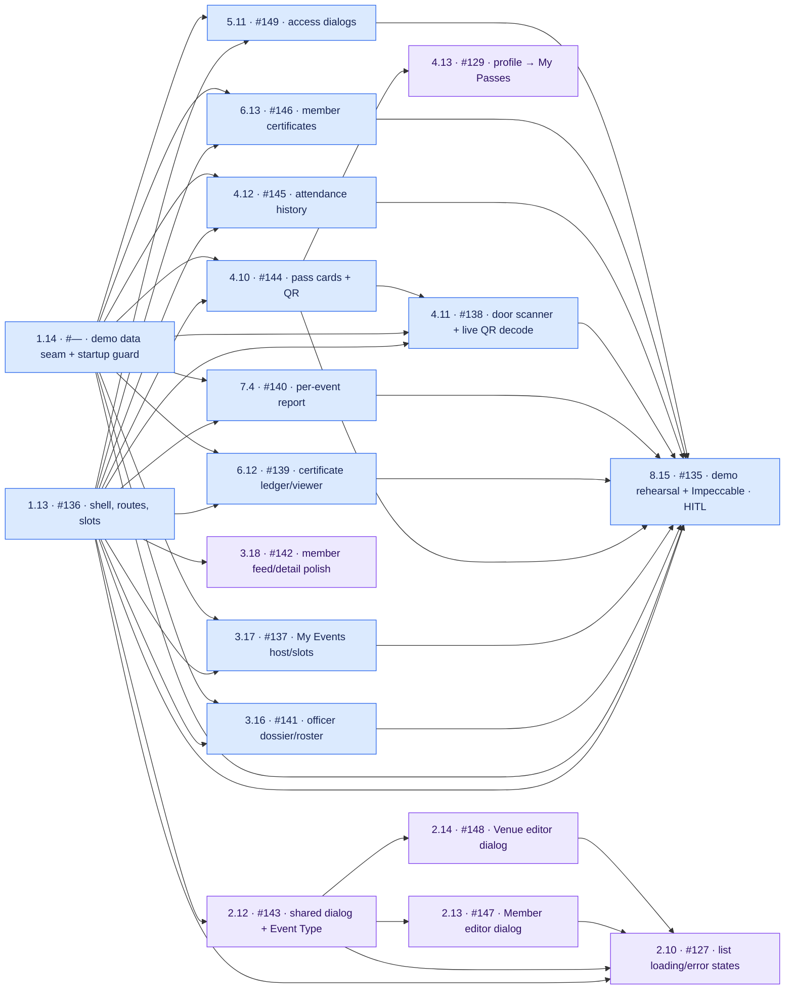
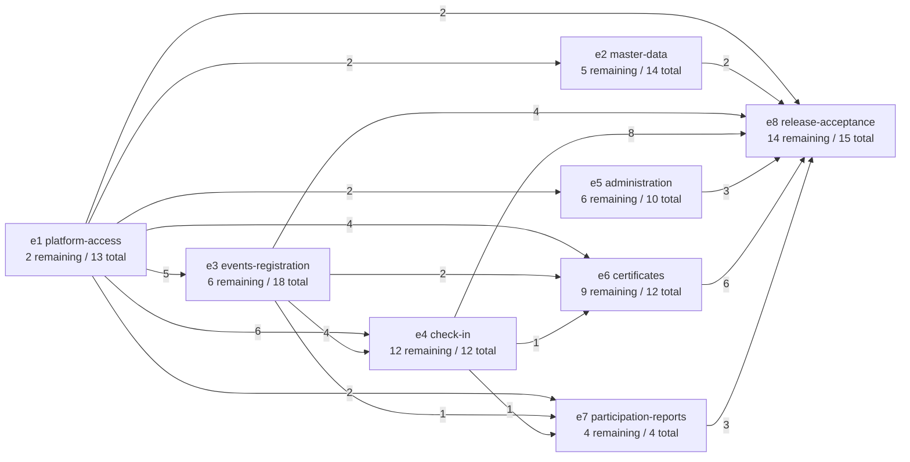
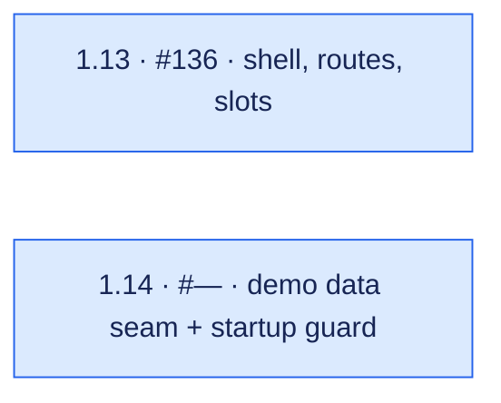
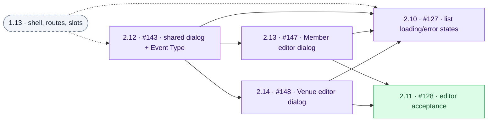
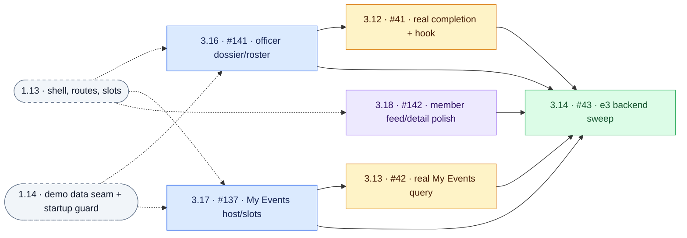
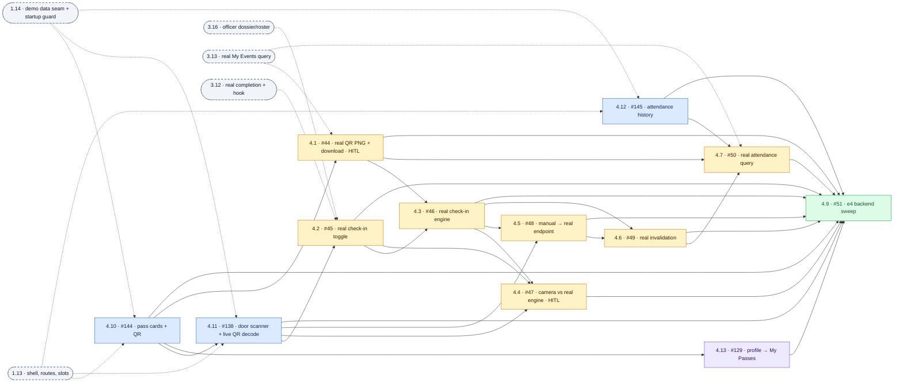
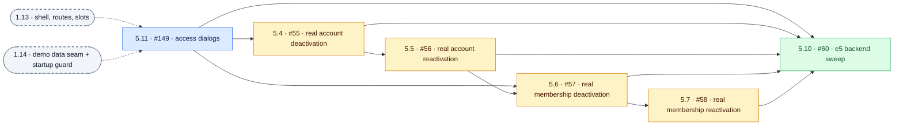
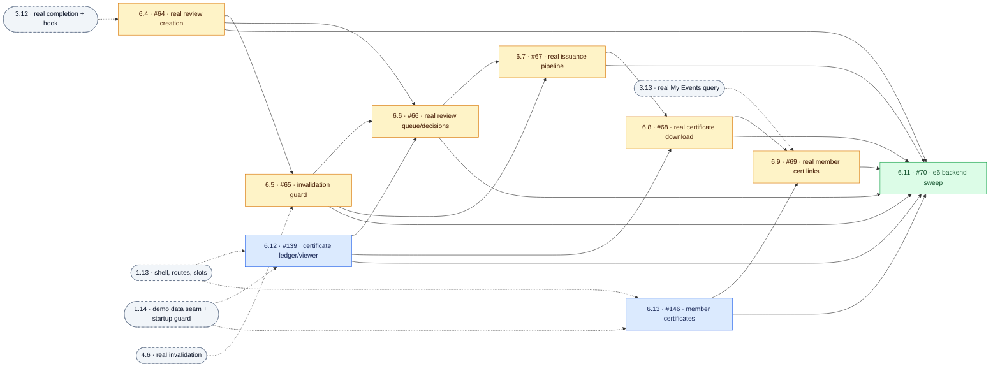
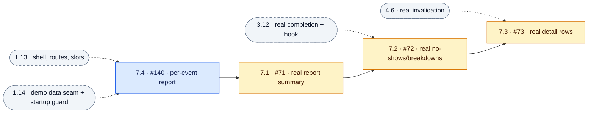
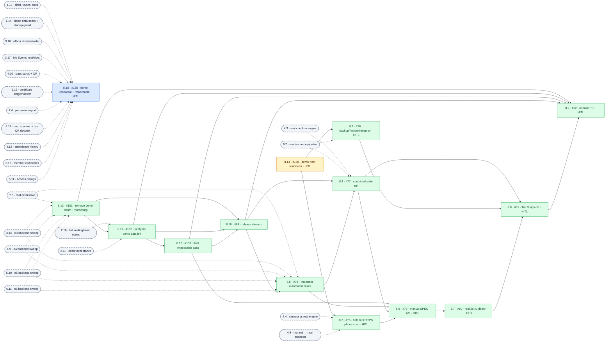

# AttendTa — demo-first dependency graphs

Snapshot: **6 November 2026**, after the demo rescope and its review fixes on branch
`docs/demo-frontend-replan`. This supersedes
[dependency-graphs-frontend-first.md](dependency-graphs-frontend-first.md); the original
[dependency-graphs.md](dependency-graphs.md) stays archived. Order and phase come from
[delivery-queue.md](delivery-queue.md); demo data rows come from
[demo-mock-register.md](demo-mock-register.md).

## Reading the graphs

- Source: the eight epic `tickets.toml` breakdowns and their `after` values, as `tickets.py status`
  reports them (no cycle, drift, unpinned or undeclared `after`, or order conflict).
- **98 tickets: 40 done, 58 remaining** — 12 demo-critical, 6 demo-polish,
  23 integration, 17 finale. Only remaining work is drawn; prerequisites
  that are already done are satisfied and omitted.
- **153 remaining story edges: 95 within epics, 58 across epics.**
- Arrows run **provider → consumer**. Solid arrows are in-epic or, in the demo graph, between
  drawn tickets; dashed arrows from rounded nodes come from tickets outside the drawn set
  (external nodes repeat for readability and are not extra tickets).
- Labels: **ref · GitHub issue · short title**. `HITL` means a person does part of the work.
  1.14 has no issue yet (`#—`).
- Colors: **blue = demo-critical**, **purple = demo-polish**, **amber = integration**,
  **green = finale**.
- The GitHub issues were not updated for the demo rescope; issue numbers are the existing ones
  (#135 now maps to 8.15). This document changes no tracker state.

## Phase summary

| Phase | Tickets | Ends when |
|---|---|---|
| Demo-critical | 1.13, 1.14, 3.16, 3.17, 4.10, 6.12, 7.4, 4.11, 4.12, 6.13, 5.11, 8.15 | 8.15 rehearsal runs the demo script and every demo-phase Verify line without a dead end |
| Demo-polish | 3.18, 4.13, 2.12, 2.13, 2.14, 2.10 | Merged before the demo if time allows; otherwise shown as they are |
| Integration | 8.14, 3.13, 3.12, 4.1, 4.2, 4.3, 5.4, 5.5, 5.6, 5.7, 6.4, 4.4, 4.5, 4.6, 4.7, 6.5, 6.6, 6.7, 6.8, 6.9, 7.1, 7.2, 7.3 | Every register row except M-01 is `removed` |
| Finale | 3.14, 4.9, 5.10, 6.11, 8.13, 8.11, 2.11, 8.12, 8.10, 8.5, 8.4, 8.2, 8.3, 8.6, 8.7, 8.8, 8.9 | Initiative Done when |

## Demo phase — what to build before the demo

Only demo-phase tickets are drawn. 1.13 (shell) and 1.14 (demo data seam) run in parallel.
After both, 3.16, 3.17, 4.10, 6.12, 7.4, 4.12, 6.13 and 5.11 are independent: 1.13 creates the
My Events slot partials and the access-action slots, so the slot fillers do not wait on 3.17
and 5.11 does not collide with 2.13. 4.11 waits on 4.10 so a real pass can be scanned. Verify
lines use the seeded demo data, so no screen waits on another screen's output.



Longest demo-critical chain (4 tickets): `1.13 → 4.10 → 4.11 → 8.15`.
With five builders the demo-critical set takes about four rounds: 1.13 and 1.14; the eight
surfaces as builders free up (4.10 first); 4.11; then 8.15. Demo-polish tickets fill idle builders
after 1.13.

## Epic graph — remaining cross-epic story edges

Counts on arrows are direct prerequisites between remaining stories, not whole-epic gates.
e8 depends on most epics because it holds 8.15 and the finale.



## Demo data: who adds and who removes each row

Exactly one ticket removes each row. 8.13 removes the seam (M-01) after every other row is gone;
8.11 then verifies, with checks that fail while any part remains.

| Register row | Added by (demo phase) | Removed by |
|---|---|---|
| M-01 | 1.14 | 8.13 |
| M-02 | 3.17 | 3.13 |
| M-03 | 4.10 | 4.1 |
| M-04 | 1.14 | 4.2 |
| M-05 | 4.11 | 4.3 |
| M-06 | 4.11 | 4.5 |
| M-07 | 4.11 | 4.6 |
| M-08 | 4.12 | 4.7 |
| M-09 | 1.14 | 3.12 |
| M-10a | 6.12 | 6.4 |
| M-10b | 6.12 | 6.6 |
| M-11a | 6.12 | 6.7 |
| M-11b | 6.12 | 6.8 |
| M-12 | 6.13 | 6.9 |
| M-13a | 7.4 | 7.1 |
| M-13b | 7.4 | 7.2 |
| M-13c | 7.4 | 7.3 |
| M-14a | 5.11 | 5.4 |
| M-14b | 5.11 | 5.5 |
| M-15a | 5.11 | 5.6 |
| M-15b | 5.11 | 5.7 |

## Dependency-only layers

A ticket's layer is the length of its longest remaining prerequisite path. Layers show what could
start together with unlimited builders; the queue rank still breaks ties.

| Layer | Tickets (queue order) |
|---:|---|
| 0 | 1.13 (critical), 1.14 (critical), 8.14 (integration) |
| 1 | 3.16 (critical), 3.17 (critical), 4.10 (critical), 6.12 (critical), 7.4 (critical), 4.12 (critical), 6.13 (critical), 5.11 (critical), 3.18 (polish), 2.12 (polish) |
| 2 | 4.11 (critical), 4.13 (polish), 2.13 (polish), 2.14 (polish), 3.13 (integration), 3.12 (integration), 5.4 (integration), 7.1 (integration) |
| 3 | 8.15 (critical), 2.10 (polish), 4.1 (integration), 4.2 (integration), 5.5 (integration), 6.4 (integration), 7.2 (integration), 3.14 (finale), 2.11 (finale) |
| 4 | 4.3 (integration), 5.6 (integration) |
| 5 | 5.7 (integration), 4.4 (integration), 4.5 (integration) |
| 6 | 4.6 (integration), 5.10 (finale), 8.2 (finale) |
| 7 | 4.7 (integration), 6.5 (integration), 7.3 (integration) |
| 8 | 6.6 (integration), 4.9 (finale) |
| 9 | 6.7 (integration) |
| 10 | 6.8 (integration), 8.3 (finale) |
| 11 | 6.9 (integration) |
| 12 | 6.11 (finale) |
| 13 | 8.13 (finale) |
| 14 | 8.11 (finale) |
| 15 | 8.12 (finale) |
| 16 | 8.10 (finale) |
| 17 | 8.5 (finale) |
| 18 | 8.4 (finale) |
| 19 | 8.6 (finale) |
| 20 | 8.7 (finale) |
| 21 | 8.8 (finale) |
| 22 | 8.9 (finale) |

### Critical dependency chain

23 tickets deep (depth, not duration):

```text
1.13 → 3.17 → 3.13 → 4.1 → 4.3 → 4.5 → 4.6 → 6.5 → 6.6 → 6.7 → 6.8 → 6.9 → 6.11 → 8.13 → 8.11 → 8.12 → 8.10 → 8.5 → 8.4 → 8.6 → 8.7 → 8.8 → 8.9
```

After the demo, the real completion, check-in and certificate backend sets the pace to release.

## e1 platform-access — 2 remaining



## e2 master-data — 5 remaining



## e3 events-registration — 6 remaining



## e4 check-in — 12 remaining



## e5 administration — 6 remaining



## e6 certificates — 9 remaining



## e7 participation-reports — 4 remaining



## e8 release-acceptance — 14 remaining



## Notes

- 8.14 (demo-host readiness) has no remaining prerequisite and may run during the demo phase.
- 2.10 waits on 2.12–2.14 because it changes the same list views their edit triggers live on.
- 6.6 waits on 6.5 because both write certificate review rows.
- 4.3 waits on 4.1 so passes carry real tokens before the real engine validates them.
- Backend tickets that wire into a demo-phase screen keep that edge so the real command replaces
  the demo data behind the screen that already exists.
