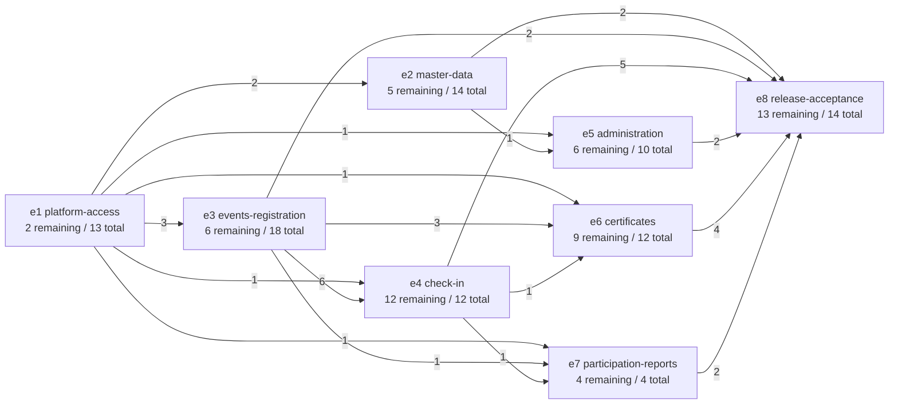
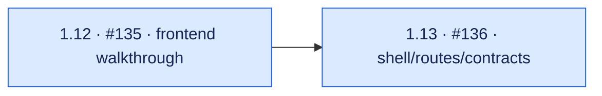
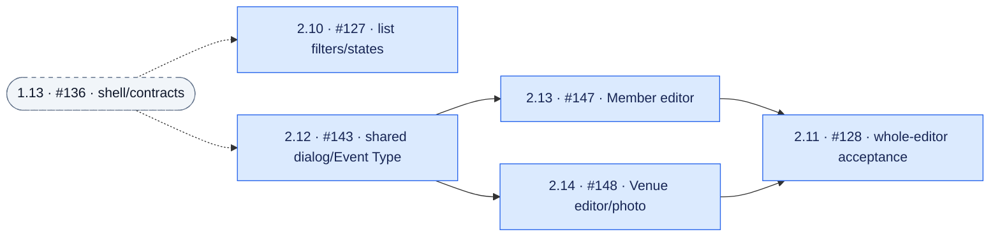
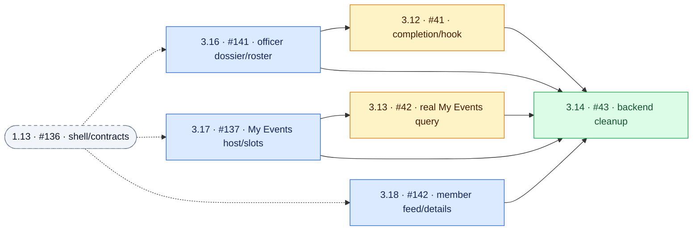
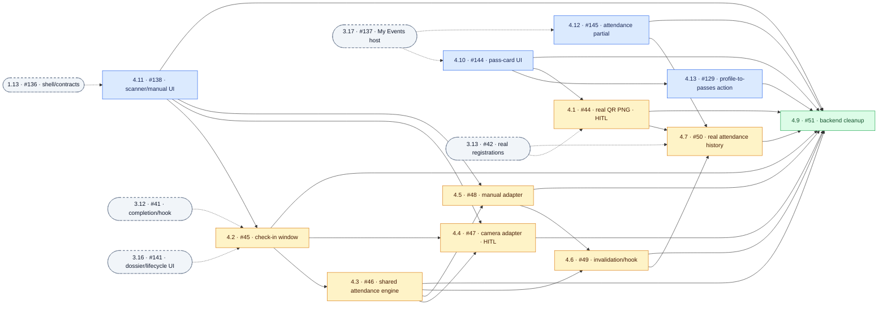
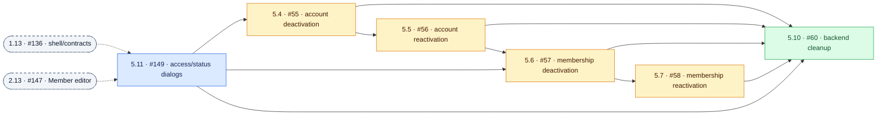
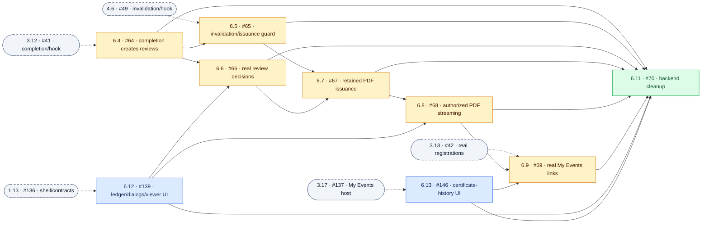
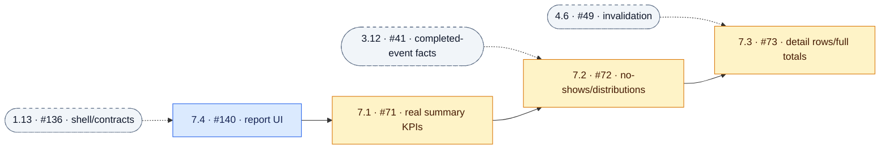
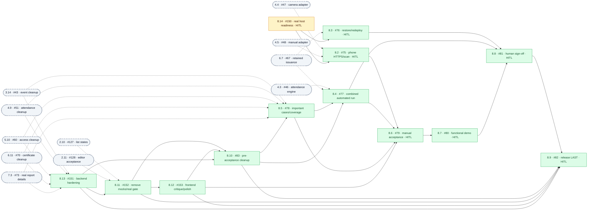

# AttendTa — frontend-first dependency graphs (superseded)

> **Superseded 2026-11-06** by [dependency-graphs-demo-first.md](dependency-graphs-demo-first.md), which reflects the demo rescope in [delivery-queue.md](delivery-queue.md): 1.12 became the closing demo rehearsal 8.15, 1.13 starts first and owns the shared demo store, 5.11 and 2.13 no longer depend on each other, 2.10 waits on 2.12–2.14, 6.6 waits on 6.5, and 2.11 moved to the finale. Kept for history only; do not dispatch from it.

Snapshot: **6 November 2026**, planning baseline `45d1c20` and wave guide `e33c5dd`.
This is a separate, current companion to [dependency-graphs.md](dependency-graphs.md).
The original document is preserved; its archived graphs are not the current execution plan.

## Reading the graphs

- Source: the eight epic breakdowns under [tickets/](tickets/), their `after` values and local
  ticket status. The [delivery queue](delivery-queue.md) supplies phase/rank, not extra blockers.
- **97 tickets total: 40 done, 57 remaining** — 18 frontend, 23 integration, 16 finale.
  Only remaining work is drawn. Prerequisites among the 40 completed tickets are satisfied and
  omitted; their implementations must be reused, not rebuilt.
- Arrows run **provider → consumer**. Each story diagram includes every remaining direct
  prerequisite of its own epic's tickets, including redundant/transitive direct edges.
  Solid arrows are in-epic; dashed arrows and rounded external nodes cross epic boundaries.
  External nodes repeat for readability and are not additional tickets.
- Labels show **BMAD ref · GitHub issue · short title**. `HITL` means human/environment
  participation, not an assigned builder. All issue numbers refer to
  [rainyDayssss/AttendTa](https://github.com/rainyDayssss/AttendTa/issues).
- Story colors: **blue = frontend phase**, **amber = integration phase**, **green = finale**.
  Phase is scheduling metadata, not an assertion that every integration ticket is backend-only.
- Five interchangeable builders take the next unclaimed, unblocked ticket; there are **no fixed
  module/person lanes**. Recheck current status and claims before dispatching this snapshot.
- This maps the plan, not completed features or passing application tests. No tracker blockers,
  priorities or assignments are changed by this document.

## Epic graph — remaining cross-epic story edges

Counts on arrows are direct prerequisites between **remaining stories**, not epic-completion
gates. There are **129 remaining story edges**, of which **39 cross epic boundaries**.
The other 90 are within epics. The capability-level `after` declarations in the root
`tickets.toml` also describe already delivered infrastructure; they are not this projection.
In particular, e8 host preparation can start now rather than waiting for whole epics.



## Shared unblockers and parallel handoffs

These counts refer to **direct remaining consumers**. A consumer becomes ready only after
all its other prerequisites are complete. This table is selective; the story graphs below are
the complete edge inventory.

| Provider | Direct consumers | Parallel opportunity / caveat |
|---|---|---|
| **1.13 · #136 shell/routes/contracts** | #137, #138, #139, #140, #141, #142, #127, #143, #149 | **Eight ready immediately**, excluding #149, which also needs #147. Take only five at a time. |
| **3.17 · #137 My Events host** | #144, #145, #146, #42, #43 | Three independent UI partials plus the real registrations query can proceed; #43 has more blockers and is held for finale cleanup. |
| **2.12 · #143 shared dialog** | #147, #148 | Member and Venue editors can proceed independently. #149 follows #147; #128 needs both editors. |
| **3.12 · #41 completion/hook** | #45, #64, #72, #43 | Window control, review creation and report calculations can proceed once their UI/summary prerequisites are met; cleanup stays late. |
| **4.3 · #46 attendance engine** | #47, #48, #49, #51, #77 | Camera/manual adapters can proceed independently. #49 still needs #48; cleanup and final tests have other prerequisites. |
| **4.6 · #49 invalidation/hook** | #50, #65, #73, #51 | **Three integrations together** when other providers are ready: attendance history, certificate invalidation guard and report details. #51 still needs #50. |
| **6.4 · #64 review creation** | #65, #66, #70 | Review decisions can proceed with #139 ready; invalidation guard also needs #49; cleanup remains late. |

Shared-provider handoffs must name actual routes, models, files and ownership boundaries.
#136 owns shell/global setup; #137 owns the My Events host and slots; #143 owns the shared
dialog primitive. Their consumers extend agreed files rather than creating competing hosts.
#47/#48 use separate adapters around one #46 engine. #41 declares `IEventCompletionHandler`
for #64; #49 declares `IAttendanceInvalidationHandler` for #65. Both certificate guards must
be present before issuance #67. Serialize shared DI/global source edits and regenerate CSS.
See [delivery-waves.md §5](delivery-waves.md#5-what-each-shared-provider-handoff-must-contain).

## Dependency-only layers — unlimited capacity

These **23 layers** are earliest starts based only on remaining `after` prerequisites.
They ignore capacity, recommended phase holds and shared-file collisions. They are **not**
the five-builder dispatch schedule. Early cleanup or phone/restore entries here are mathematical
readiness, not a recommendation to run them before the integrated build is stable.

| Layer | Stories (GitHub issue) |
|---:|---|
| 1 | 1.12 (#135), 8.14 (#150) |
| 2 | 1.13 (#136) |
| 3 | 3.17 (#137), 4.11 (#138), 6.12 (#139), 7.4 (#140), 3.16 (#141), 3.18 (#142), 2.10 (#127), 2.12 (#143) |
| 4 | 4.10 (#144), 4.12 (#145), 6.13 (#146), 2.13 (#147), 2.14 (#148), 3.13 (#42), 3.12 (#41), 7.1 (#71) |
| 5 | 5.11 (#149), 4.13 (#129), 2.11 (#128), 4.1 (#44), 4.2 (#45), 6.4 (#64), 7.2 (#72), 3.14 (#43) |
| 6 | 4.3 (#46), 5.4 (#55), 6.6 (#66) |
| 7 | 5.5 (#56), 4.4 (#47), 4.5 (#48) |
| 8 | 5.6 (#57), 4.6 (#49), 8.2 (#75) |
| 9 | 5.7 (#58), 4.7 (#50), 6.5 (#65), 7.3 (#73) |
| 10 | 6.7 (#67), 4.9 (#51), 5.10 (#60) |
| 11 | 6.8 (#68), 8.3 (#76) |
| 12 | 6.9 (#69) |
| 13 | 6.11 (#70) |
| 14 | 8.13 (#151) |
| 15 | 8.11 (#152) |
| 16 | 8.12 (#153) |
| 17 | 8.10 (#83) |
| 18 | 8.5 (#78) |
| 19 | 8.4 (#77) |
| 20 | 8.6 (#79) |
| 21 | 8.7 (#80) |
| 22 | 8.8 (#81) |
| 23 | 8.9 (#82) |

### Critical dependency chain

One longest remaining chain has **23 nodes / 22 edges**:

```text
1.12 #135 → 1.13 #136 → 3.16 #141 → 3.12 #41 → 4.2 #45
→ 4.3 #46 → 4.5 #48 → 4.6 #49 → 6.5 #65 → 6.7 #67
→ 6.8 #68 → 6.9 #69 → 6.11 #70 → 8.13 #151 → 8.11 #152
→ 8.12 #153 → 8.10 #83 → 8.5 #78 → 8.4 #77 → 8.6 #79
→ 8.7 #80 → 8.8 #81 → 8.9 #82
```

This is dependency depth, **not hours or a duration-weighted forecast**. Parallelism cannot
remove these handoffs; merge/check the shared providers promptly rather than race their files.

## Recommended waves — five interchangeable builders

This is the **25-batch** sequence in [delivery-waves.md](delivery-waves.md), condensed to IDs.
Each remaining ticket appears once. At most five implementations run across all active batches;
a consumer may start once its own prerequisites merge, without waiting for unrelated work.
Prefer ready frontend tickets by queue rank, filling spare capacity with ready integration.
#150 is an early host-preparation side path and appears once. Park it if human inputs are missing.

| Batch | Tickets (GitHub issues) | Handoff |
|---:|---|---|
| 1 | #135, #150 | Walkthrough plus parallel host preparation |
| 2 | #136 | Shared shell/routes/contracts |
| 3 | #137, #138, #139, #140, #141 | First five frontend surfaces |
| 4 | #142, #127, #143, #144, #145 | Dialog primitive and My Events partials |
| 5 | #146, #147, #148, #129, #42 | Ready frontend first; real My Events query fills spare slot |
| 6 | #149, #128, #41, #44, #71 | Initial frontend complete; completion/QR/report providers |
| 7 | #45, #55, #64, #72 | Window, access, reviews and calculations |
| 8 | #46, #56, #66 | Shared engine and real review decisions |
| 9 | #57, #47, #48 | Separate camera/manual adapters |
| 10 | #58, #49 | Finish invalidation provider |
| 11 | #50, #65, #73 | Three integrations released by #49 |
| 12 | #67 | Retained transactional certificate issuance |
| 13 | #68 | Authorized retained-PDF stream |
| 14 | #69 | Real certificate links; integration checkpoint |
| 15 | #43, #51, #60, #70 | Focused module cleanup sweeps |
| 16 | #151 | Cross-module backend hardening |
| 17 | #152 | Remove required runtime mocks; real integration gate |
| 18 | #153 | Real-frontend walkthrough/refactor/polish |
| 19 | #83 | Pre-acceptance cleanup |
| 20 | #78, #75, #76 | Important case authoring plus phone/restore evidence |
| 21 | #77 | Combined automated execution |
| 22 | #79 | Full manual SPEC acceptance |
| 23 | #80 | Functional demo |
| 24 | #81 | Human sign-off on exact tested commit |
| 25 | #82 | Release PR and human merge — last |

Holding module sweeps until Batch 15 and phone/restore checks until after #83 are **execution
recommendations**, not extra `after` edges. They are intentionally absent from the graphs.
One builder can follow the table top to bottom, left to right, parking blocked host preparation.

## e1 platform-access — 2 remaining



## e2 master-data — 5 remaining



## e3 events-registration — 6 remaining



Reuse the delivered registration/cancellation rules. #43 is mathematically ready early but is
held until the integration checkpoint to avoid racing #45 on lifecycle interfaces.

## e4 check-in — 12 remaining



There is **no camera → manual dependency**. Both adapters use #46; manual fallback must not
wait for camera success. #49 is not ready from #46 alone: it also requires #48.

## e5 administration — 6 remaining



Reuse the delivered cancellation service and preview. The access sequence is serial because
these tickets share administration sources; it is not a new dependency on the scanner module.

## e6 certificates — 9 remaining



Completion/review creation and invalidation must share their caller-owned transaction/hook
contracts. #67 requires **both #65 and #66**; a working viewer is not permission to issue early.
The issuance → authorized stream → member links chain is intentionally serial.

## e7 participation-reports — 4 remaining



Summary reads use delivered canonical facts; #71 does not wait for the whole scanner epic.
No-shows need completed-event behavior; final detail rows also need invalidation.

## e8 release-acceptance — 13 remaining



#150 has no **remaining** prerequisite: completed #74 supplied provisioning tooling, not proof
of real-host readiness. Prepare host/HTTPS inputs early, while actual #75/#76 verification is
recommended after cleanup #83. No synthetic #83 → #75/#76 edges are added to this diagram.
The release join #82 requires #151, #152, #153, #83 and #81; no planned cleanup follows release.

## Delivery safeguards

- Reuse ready backend implementations. Temporary data is permitted only for missing integrations,
  isolated under the shared prototype contract with an accountable replacement ticket. It must
  not perform real writes, fake successful mutations or survive the #152 release gate.
- Development checks stay small and targeted; existing required CI remains enabled. The finale
  completes backend hardening, removes mocks, polishes the real UI, then runs important tests.
  [finale-test-cases.md](finale-test-cases.md) retains full SPEC/manual coverage obligations.
- **UI-facing tickets only:** use Impeccable for implementation, rendered critique and polish.
  This includes UI-facing integrations; backend-only, test-only and operations tickets do not
  inherit a design-tool requirement. Preserve `docs/DESIGN.md` and update product context as needed.
- Nine remaining HITL tickets: #44, #47, #75, #76, #79, #80, #81, #82 and #150. Human/environment
  delays are real blockers on their downstream paths, not permission to report an unverified pass.
- Evidence must identify the exact tested commit. After fixes, retest affected cases; do not count
  this graph, fixtures or planning verification as final product acceptance.
