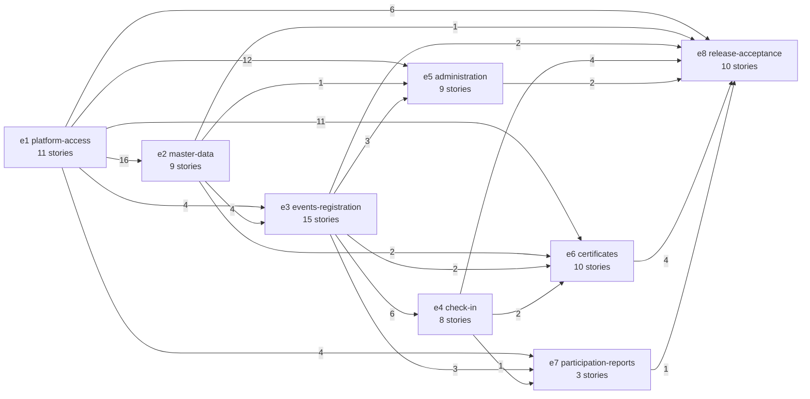
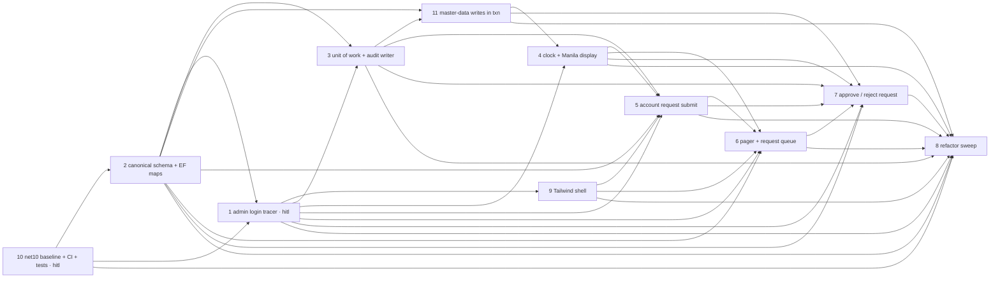
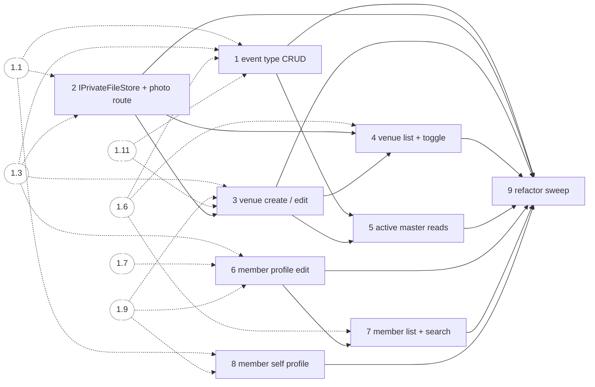
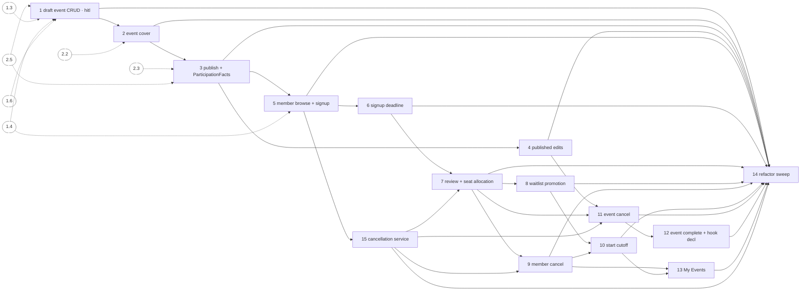
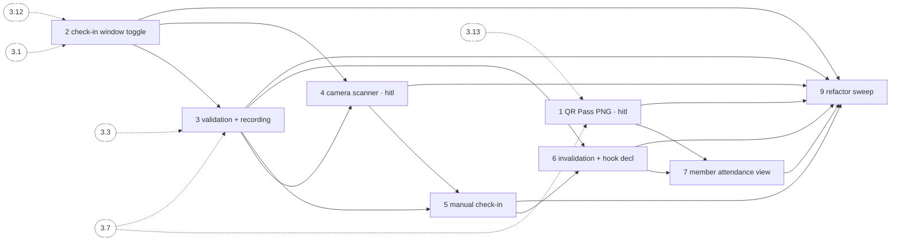
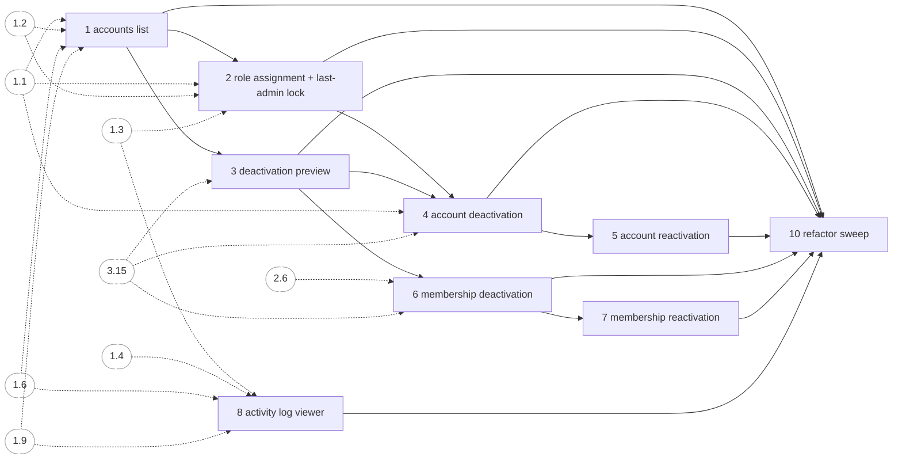
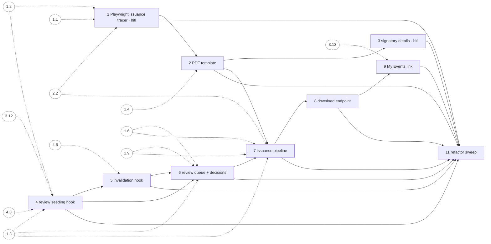
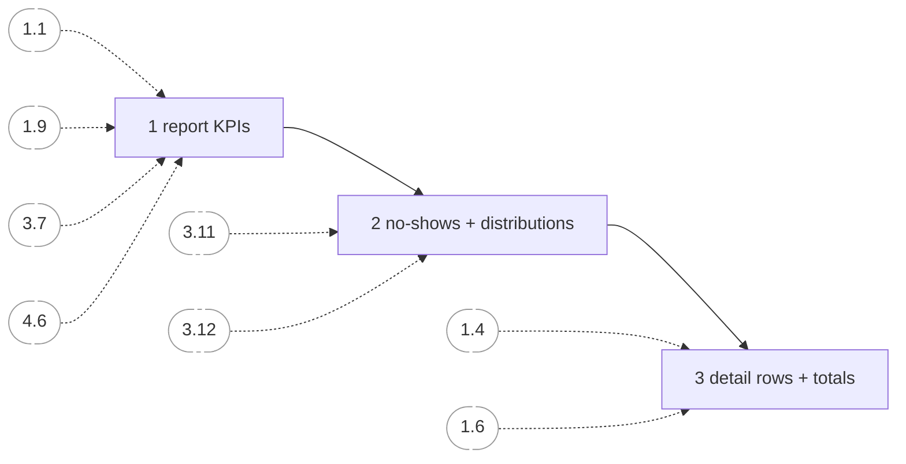
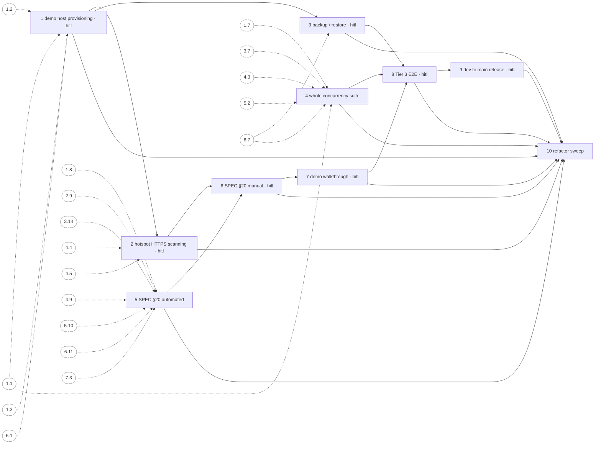

# AttendTa dependency graphs

Source: `_bmad-output/initiative-attendta/tickets/` at commit `420f72c`. Solid arrow = same epic, provider → consumer. Dashed arrow = prerequisite story in another epic. `hitl` marks a step a person runs.

## Epic graph (count = prerequisite edges between the epics' stories)

Build order: e1 → e2 → e3 → e4 → e5 → e6 → e7 → e8. e5 does not wait on e4: it takes the Valid Attendance exemption through e3.15 and ParticipationFacts (3.3) and seeds attendance rows in its own tests. e7 has no in-epic cross dependency to e5.

Hubs, by how many later stories name them: 1.1 sign-in (17), 1.3 unit of work and audit writer (15), 1.2 canonical schema (12), 1.9 shell (11), 1.6 pager (11), 1.4 clock (9), 3.7 seat allocation (8), 3.15 cancellation service (7).

## Waves (earliest possible start with unlimited parallelism)

| Wave | Stories |
| --- | --- |
| 0 | 1.10 |
| 1 | 1.2 |
| 2 | 1.1 |
| 3 | 1.3, 1.9 |
| 4 | 1.11, 2.2, 2.8 |
| 5 | 1.4, 2.3, 6.1 |
| 6 | 1.5, 6.2, 8.1 |
| 7 | 1.6, 6.3 |
| 8 | 1.7, 2.1, 2.4, 5.1, 5.8 |
| 9 | 1.8, 2.5, 2.6, 5.2 |
| 10 | 2.7, 3.1 |
| 11 | 2.9, 3.2 |
| 12 | 3.3 |
| 13 | 3.4, 3.5 |
| 14 | 3.6, 3.15 |
| 15 | 3.7, 5.3 |
| 16 | 3.8, 3.9, 3.11, 5.4, 5.6 |
| 17 | 3.10, 3.12, 5.5, 5.7 |
| 18 | 3.13, 4.2, 5.10 |
| 19 | 3.14, 4.1, 4.3 |
| 20 | 4.4, 6.4 |
| 21 | 4.5 |
| 22 | 4.6, 8.2 |
| 23 | 4.7, 6.5, 7.1 |
| 24 | 4.9, 6.6, 7.2 |
| 25 | 6.7, 7.3 |
| 26 | 6.8, 8.3, 8.4 |
| 27 | 6.9 |
| 28 | 6.11 |
| 29 | 8.5 |
| 30 | 8.6 |
| 31 | 8.7 |
| 32 | 8.8 |
| 33 | 8.9 |
| 34 | 8.10 |

The critical path runs 1.10 → 1.2 → 1.1 → 1.3 → 1.11 → 1.4 → 1.5 → 1.6 → 2.1 → 2.5 → 3.1 → 3.2 → 3.3 → 3.5 → 3.15 → 3.7 → 3.11 → 3.12 → 4.2 → 4.3 → 4.4 → 4.5 → 4.6 → 6.5 → 6.6 → 6.7 → 6.8 → 6.9 → 6.11 → 8.5 → 8.6 → 8.7 → 8.8 → 8.9 → 8.10: 35 stories.

## e1 platform-access

## e2 master-data

## e3 events-registration

## e4 check-in

## e5 administration

## e6 certificates

## e7 participation-reports

## e8 release-acceptance

