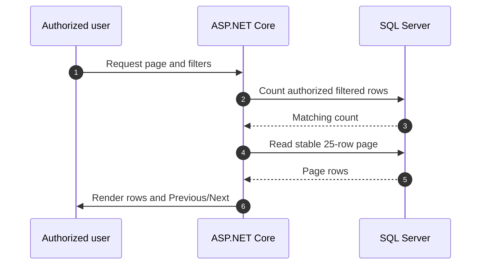
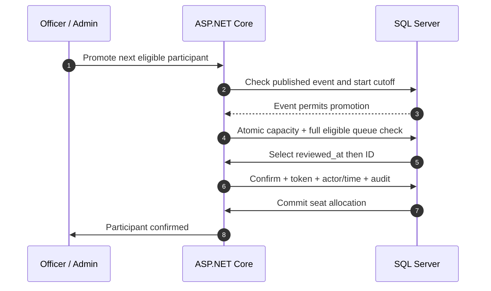
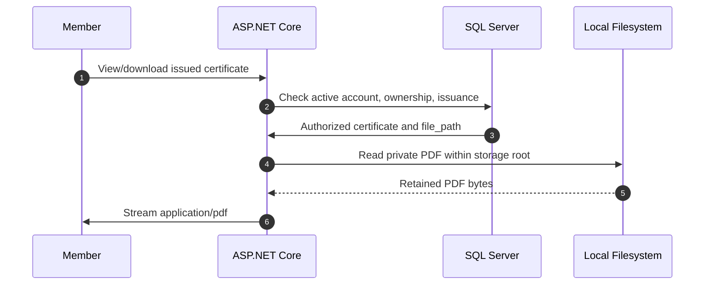

# AttendTa — Revised MVP Sequence Diagrams

Version: 2.1 — UC-aligned reduced MVP
Requirements baseline: `../docs/UC-Project-FL (1).pdf`, plus the explicit refinements agreed in the scope review.
Stated original submission deadline: October 7, 2026 (historical; not a new delivery promise).

These revised copies supersede the broader workflow descriptions for this revised baseline only. Original files in `docs/` remain unchanged. The original specification v1.3 describes the previous scope and must not override these agreed refinements. Ten core business tables are retained; SQL Server lookup tables implement the readable DBML enums.

Open `AttendTa-Sequence-Diagrams.html` for offline static SVG views. The Mermaid below is editable source. Successful paths are shown; adjacent notes describe guards and failure handling. SQL mutations include audit entries. Routine acknowledgments are omitted.

## Browse authorized lists

**Stories:** US-29



Fixed 25 rows. Apply role/owner filters before count/slice and ID tie-breaker before paging. Full report totals and waitlist selection are independent of pages. Reset on changed filters and handle empty/out-of-range pages.

## Account request and approval

**Stories:** US-01–03

```mermaid
sequenceDiagram
    autonumber
    participant P0 as Applicant
    participant P1 as Officer / Admin
    participant P2 as ASP.NET Core
    participant P3 as SQL Server
    P0->>P2: Submit details and password
    P2->>P3: Validate duplicates; save hash
    P3-->>P2: Pending request saved
    P2->>P0: Acknowledge submission
    P1->>P2: Approve request
    P2->>P3: Atomic user/member approval + audit
    P3-->>P2: Approval committed; request hash cleared
    P2->>P1: Approval recorded
    P0->>P2: Later login with email/password
    P2->>P3: Read active account and hash
    P3-->>P2: Account credentials and role
    P2->>P0: Validate hash; issue signed cookie
```

Rejection instead records reason and clears request hash without creating an account. Applicant receives no automated email/public tracking; outcome communication is officer-managed offline for the demo. No login bypass or reversible credential storage.

## Upload or replace event/venue image

**Stories:** US-09–11

```mermaid
sequenceDiagram
    autonumber
    participant P0 as Officer / Admin
    participant P1 as ASP.NET Core
    participant P2 as Local Filesystem
    participant P3 as SQL Server
    P0->>P1: Submit JPEG/PNG image
    P1->>P3: Check management role and event lifecycle
    P3-->>P1: Record and current path
    P1->>P2: Validate content; write unique file
    P2-->>P1: New relative path
    P1->>P3: Commit image_path and audit
    P3-->>P1: Path update committed
    P1->>P2: Remove old file after commit
    P1->>P0: Display current image
```

Maximum 2 MiB. User profile-picture uploads are not included. Venue photo mandatory at creation; draft cover optional but required before publication. Required images cannot be removed without replacement. Lifecycle restrictions apply. On failed SQL save clean up/reconcile the new file and retain old path/file. Persistent local root outside web/deployment directory; no physical paths sent to clients.

## Publish, register and approve

**Stories:** US-11–16

```mermaid
sequenceDiagram
    autonumber
    participant P0 as Member
    participant P1 as Officer / Admin
    participant P2 as ASP.NET Core
    participant P3 as SQL Server
    P1->>P2: Publish draft with required cover
    P2->>P3: Validate masters, cover, future deadline
    P3-->>P2: Publish and audit committed
    P2->>P1: Published; signup now open
    P0->>P2: Submit signup before deadline
    P2->>P3: Validate; save pending + snapshots
    P3->>P2: Pending registration saved
    P2->>P0: Pending review
    P1->>P2: Approve before event start
    P2->>P3: Atomic eligibility/capacity/queue check
    P3-->>P2: Confirmed + token + audit committed
    P2->>P1: Confirmation result
```

Available-seat path without earlier eligible waitlist. Otherwise approval produces waitlisted. Review may occur after signup deadline but before start. No separate manual registration opening. Only descriptive edits/cover replacement after publish; operational fields locked. Ordinary role permissions also apply to own participation; audit all decisions. No arbitrary status editing.

## Cancel a registration

**Stories:** US-17

```mermaid
sequenceDiagram
    autonumber
    participant P0 as Member
    participant P1 as ASP.NET Core
    participant P2 as SQL Server
    P0->>P1: Confirm final cancellation
    P1->>P2: Check owner, cutoff, attendance
    P2->>P1: Cancellation permitted
    P1->>P2: Cancel + invalidate token + audit
    P2->>P1: Seat released; commit complete
    P1->>P0: Cancelled; no reapplication
```

Allowed while event published and before start without valid attendance, including after signup deadline. Seat release does not automatically promote anyone. Officer explicitly runs the separate promotion action.

## Officer-triggered waitlist promotion

**Stories:** US-18



Select earliest eligible reviewed waitlisted request across the entire queue, not the visible page. Preserve original reviewer. All checks and updates belong to one seat-allocation transaction. If no candidate or no capacity, do not mutate. No automatic promotion or emails; member sees new QR/status on next authorized visit.

## Reject signup at the deadline

**Stories:** US-12, US-19

```mermaid
sequenceDiagram
    autonumber
    participant P0 as Member
    participant P1 as ASP.NET Core
    participant P2 as SQL Server
    P0->>P1: Submit previously opened signup form
    P1->>P2: Read event deadline and current state
    P2->>P1: Published event; deadline reached
    P1->>P0: Reject: registration closed
```

At now >= deadline new signup is rejected server-side; event stays published. Existing reviews/promotions/cancellations may continue until start. At now >= start reject those too; pending/waitlisted remain visibly non-actionable history, excluded from no-shows. Check-in has its own manual gate. Store UTC; display labelled local time. No scheduled status rewrite.

## Saved QR and attendance check-in

**Stories:** US-20–23

```mermaid
sequenceDiagram
    autonumber
    participant P0 as Member
    participant P1 as Officer / Admin
    participant P2 as ASP.NET Core
    participant P3 as SQL Server
    P0->>P2: Request own confirmed event QR
    P2->>P3: Authorize owner; read token
    P3->>P2: Confirmed eligible registration
    P2->>P0: Generate PNG for display/download
    P1->>P2: Open event check-in
    P2->>P3: Save check-in state + audit
    P0->>P1: Present saved QR at venue
    P1->>P2: Scan QR for selected event
    P2->>P3: Atomic eligibility + duplicate check
    P2->>P3: Insert attendance + audit
    P3-->>P2: Attendance committed
    P2->>P1: Success with participant identity
```

Officer requires internet; member may use screenshot offline. Validate event match, open check-in, active account/member and confirmed registration; unique constraint prevents simultaneous duplicate scans. Manual search requires explicit Check in with same service. Invalidated attendance cannot be rechecked in this release; issued certificates block invalidation.

## Complete, approve and issue PDF

**Stories:** US-14, US-24–25

```mermaid
sequenceDiagram
    autonumber
    participant P0 as Officer / Admin
    participant P1 as ASP.NET Core
    participant P2 as SQL Server
    participant P3 as Local Filesystem
    P0->>P1: Complete concluded event at/after start
    P1->>P2: Close check-in; complete; audit
    P1->>P2: Create pending valid-attendee reviews
    P0->>P1: Approve certificate eligibility
    P1->>P2: Validate attendance; save reviewer + audit
    P0->>P1: Issue one eligible certificate
    P1->>P2: Prepare unique number and snapshots
    P2-->>P1: Issuance data
    P1->>P3: Generate fixed-template private PDF
    P3->>P1: Saved relative file path
    P1->>P2: Recheck; commit issued metadata + audit
    P1->>P0: Issued only after successful commit
```

One fixed landscape A4 template with embedded fonts. Eligibility review and issuance share event-attendee management. Ordinary role permissions permit own-certificate decisions with the same checks/audit. Declined decisions cannot reopen. No bulk issuance, email, revocation or reissue. Prevent concurrent duplicate issuance; final attendance/eligibility recheck must serialize with correction. File and SQL writes are not one transaction: never mark issued on file failure; clean up/reconcile orphan PDF after failed commit. Retain immutable PDF and snapshots.

## Authorized certificate download

**Stories:** US-25



Authorized management uses equivalent permission checks. Membership inactivity alone does not revoke historical certificates; inactive accounts cannot authenticate. Reject path traversal; never expose PDFs through static middleware or physical paths. Later profile/event edits cannot overwrite issued content.

## Shared policy reference

See `AttendTa-User-Stories.md` and `AttendTa-System-Specification.md` for acceptance criteria, authority, cutoffs, storage and deferred features. These are workflow views, not separate screens: personal registration/QR/attendance/download use My Events, and certificate review/issuance use event-attendee management. US-04 (Change Password) is deferred. Reports show attendee-only course/year distribution; logs use a basic read-only viewer.
