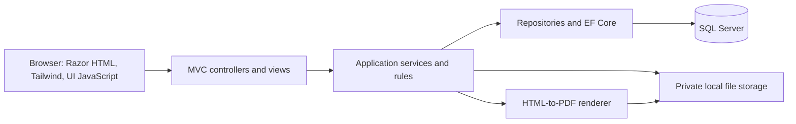

# AttendTa architecture

Version 1.1 | 4 November 2026 | Target design and implementation baseline

Read [prd.md](prd.md) for product behavior and [design.md](design.md) for visual presentation. This document describes the current code boundary and the target implementation. Proposed interfaces, configuration, and algorithms below are engineering decisions to validate; their presence here does not mean they exist in the repository.

## 1. Baseline and status

| Reference | Verified context |
|---|---|
| Team repository | `https://github.com/rainyDayssss/AttendTa`, upstream dev `44eda46af770ef84484499eb58c8738bf9553573`, inspected 4 November 2026. |
| Initial commit | `174d1fd7e20c6a8b9095d9a351e1d058da550511`: original MVC starter; historical context, not the target feature baseline. |
| Current local checkout/fork dev | `429d949bea40b3860fd7164007881008439cc956`; local checkout is feature/participation-reports. Latest upstream adds documentation only. |
| Independent branches | Admin roles `7477e95`; certificate eligibility `0be8898`: contracts, pure rules, and tests, not completed Data/HTTP integrations. |
| Visual prototype | `F:/AttendTa`, inspected HEAD `f65b054`; inspected working files, not an assertion that the worktree is clean. HTML/CSS/assets are visual evidence only. |

Existing solution: .NET 9, ASP.NET Core MVC, EF Core SQL Server, four projects (WebApp, Services, Data, Resources), repositories/unit of work, DI, AutoMapper, logging, and Razor views. Master Data code and an MVP SQL script exist. Login is still a fabricated user-ID-0 stub; the User mapping remains legacy. Canonical participation mappings and shared workflows are incomplete. The starter UI loads Bootstrap; the intended UI is Tailwind. Existing SQL uses string CHECK states, unlike the required lookup FKs. No build, SQL execution, or integration test is claimed by this document.

## 2. System shape

Use one application and one SQL Server database on the development/demo host. Browsers connect locally or through a hotspot/LAN. Files and PDF generation stay on that host. Do not introduce microservices, cloud storage, queues, or a scheduler for the MVP.



Browser JavaScript handles dialogs, previews, navigation, and scanner input. Business decisions, access checks, aggregate queries, and persistence belong on the server. Do not carry over localStorage records, role switches, fake credentials, prototype status schemas, folder routes, or sample numeric values.

## 3. Project responsibilities

| Project | Responsibility |
|---|---|
| ASI.Basecode.WebApp | MVC actions, request validation, trusted identity, HTTP outcomes, Razor views/layouts/partials, Tailwind assets, frontend scripts, authorized file responses, framework adapters. |
| ASI.Basecode.Services | Application use cases, business rules, DTOs/view models, transaction orchestration through Data abstractions, and interfaces for storage/PDF/hash collaborators. |
| ASI.Basecode.Data | Canonical database-first entities/mappings, repositories, query projections, shared unit of work and transaction support. |
| ASI.Basecode.Resources | Shared messages, labels, constants. |

Keep dependencies WebApp → Services → Data; Data never references Services DTOs. Adapt existing base controllers/repositories and DI registrations rather than creating a competing application. Register only working service implementations. Pure feature-branch rules remain reusable after validation against this baseline.

Controllers remain thin. Return safe DTOs, not serialized EF entities or unrestricted IQueryable. Put filtering, counts, grouping, and paging in database queries. Async I/O should accept cancellation tokens. Do not rewrite unrelated modules merely to standardize style.

### 3.1 Folder structure

The following extends the existing basecode. Entries marked `[planned]` are proposed locations, not existing files or a command to create empty scaffolding. Keep teammates' equivalent existing implementations rather than duplicating them. No new Domain project, separate frontend application, or Razor Pages migration is required.

```text
AttendTa/
  ASI.Basecode.sln
  ASI.Basecode.WebApp/
    Program.cs
    Startup.cs / Startup.DI.cs / Startup.AutoMapper.cs / Startup.Auth.cs
    Controllers/                  MVC actions; retain current Member/EventType/Venue controllers
    Models/                       HTTP-specific models and framework configuration
    Mvc/                          Existing controller helpers
    Authentication/               Real sign-in and current-account validation
    Configuration/                Typed options and configuration adapters
    Storage/                      Existing venue adapter; shared private-file adapters [extend]
    Rendering/                    Razor-to-HTML and HTML-to-PDF adapters [planned]
    Styles/                       Tailwind source entry point [planned]
    Views/
      Shared/                     Shared layouts, navigation, dialogs, paging, validation
      Account/                    Login and account request
      Member/ / EventType/ / Venue/  Existing master-data view conventions
      AccountRequest/             Approval queue and review [planned]
      Profile/                    Personal read-only profile [planned]
      Event/ / Registration/      Management forms, rosters, review actions [planned]
      MyEvents/                   Member browsing/details/history/pass views [planned]
      Attendance/                 Scanner, manual lookup, correction [planned]
      Certificate/                Review queue, issuance, PDF template [planned]
      Report/                     Per-event participation [planned]
      Administration/             Accounts/roles and audit list [planned]
    wwwroot/
      css/                        Compiled CSS and necessary shared styles
      js/                         UI interactions and scanner integration
      img/ / fonts/               Static branding, icons, fonts; no private certificates
    appsettings.json             Nonsecret defaults only
    package.json                 Pinned frontend build dependencies/scripts [planned]
  ASI.Basecode.Services/
    Interfaces/                   Use-case and collaborator contracts
    Services/                     Application service implementations
    ServiceModels/                Feature DTOs, validation, view models
    AccountAdministration/        Pure rules already present on feature branch
    CertificateEligibility/       Pure rules already present on feature branch
    Manager/                      Existing helpers; replace unsafe credential behavior
  ASI.Basecode.Data/
    AsiBasecodeDbContext.cs
    Models/                       Canonical entities and Data-owned projections
    Interfaces/ / Repositories/   Query/write contracts and EF implementations
    UnitOfWork.cs                 Shared context and transaction support
  ASI.Basecode.Resources/
    Constants/ / Messages/        Shared codes and user-facing messages
  database/                       Reviewed canonical schema, lookups, setup scripts
  tests/                          Feature unit tests and SQL/HTTP integration tests
  bruno/                          Manual endpoint checks; align with real authentication
  docs/                           Team handoffs and repository documentation

Configured external storage root (outside this repository and wwwroot):
  uploads/venues/
  uploads/events/
  certificates/
  temporary/                      Uncommitted renderer/upload outputs
```

These PRD/design/architecture files currently live in the workspace's `docs/docsss`, outside the application checkout. Their placement does not require moving or overwriting existing repository docs. `bin`, `obj`, browser binaries, generated user files, secrets, and local database backups are not source folders to copy from the prototype.

### 3.2 HLD-to-MVC responsibility map

Names below are proposed controller/view boundaries, not frozen URLs. Keep the 20 HLD screen identities for visual review; several screens may share a controller/layout. Supporting dialogs belong with their parent view and can use partials.

| HLD screens | MVC responsibility |
|---|---|
| 1 Login; 2 Membership request | Account controller/views |
| 3 Account requests | AccountRequest controller/views |
| 4 My profile | Profile controller/view; authorized current user |
| 5 Members; 6 Event types; 7 Venues | Existing Member, EventType, Venue controllers/views |
| 8 Event management; 9 Create event; 10 Event details/registrations | Event views with Registration actions and shared roster partials |
| 11 Browse events; 12 Member event details; 13 My passes; 15 My attendance/history | MyEvents views with personal registration, QR, attendance, and certificate data |
| 14 Door scanner | Attendance view and check-in/correction actions |
| 16 Certificates; 17 Certificate viewer | Certificate management views and authorized retained-PDF response |
| 18 Participation reports | Report controller/view |
| 19 Accounts/roles; 20 Activity history | Administration controller/views |

Adapt visual markup, then bind typed models. Extract shared navigation and dialogs instead of copying full prototype pages. Generate application links through MVC routing; do not preserve `.html` paths. Keep certificate print CSS separate from page chrome. Compile Tailwind against Razor and relevant JavaScript sources, including explicit mappings for dynamic badge classes; runtime-constructed class names must not disappear from the CSS build.

## 4. Module contracts and integration

| Module | Provides | Depends on |
|---|---|---|
| Auth | Pending requests, atomic approval, Argon2 hashing/verification, real authenticated actor/current role. | User/member mappings, shared audit, approved-member creation. |
| Master Data | Members, types, venues, image validation, eligibility facts. | Auth-linked identity, shared cancellation on membership inactivity. |
| Events/Registration | Lifecycle, signup snapshots, transactional seat allocation, explicit promotion, cancellation and token creation. | Current account/member eligibility, masters, audit. |
| Attendance/QR | Token rendering/lookup, check-in gate, one attendance record, correction. | Registration/events, current eligibility, certificate issued-state guard. |
| Certificates | Eligibility decisions, final issuance checks, immutable snapshots, PDF creation and authorized retrieval. | Completed event, valid attendance, registration, private storage, audit. |
| Reports | Authorized per-event read models and aggregates. | Canonical registration/attendance/snapshot facts; no participation mutations. |
| Administration | Role/access changes, last-admin protection, basic activity reader. | Current Auth, shared registration cancellation, transaction/audit infrastructure. |

Agree method signatures with teammates before integration. Contracts must identify trusted actor/time, caller-owned transaction, whether SaveChanges occurs, failures, and retry behavior. Do not implement a second cancellation or attendance-validity definition inside another feature. Registration owns participation cancellation; account/member workflows call it atomically. Attendance correction and certificate issuance share the same serialization rules.

### Request and error handling

Use GET for reads and POST for state changes, including logout; do not mutate records through navigation links. Bind explicit request models containing only allowed fields and expected state when needed. Resolve actor identity and UTC time on the server. Validate field constraints, then current business state inside the transaction. A hidden/disabled button is not authorization.

Successful form posts redirect to a GET to avoid accidental resubmission. Validation failures redisplay the entered model and field errors. Use semantic outcomes such as invalid input, forbidden, not found, stale state, duplicate, capacity unavailable, and file failure; controllers translate them into suitable page feedback or HTTP responses for scanner/AJAX requests. Never expose SQL errors, stack traces, hashes, or tokens. Reload current state after a conflicting action rather than pretending the stale form succeeded.

Business audit is separate from diagnostic logging: audit records belong to the mutation transaction; technical logs record failures with a correlation identifier and safe context. Logs cannot replace rollback or durable audit history.

## 5. Database design

Follow [AttendTa-MVP.dbml](AttendTa-MVP.dbml) and specification §18: ten business tables plus seeded lookup tables. Lookup values are fixed system data, not editable master screens. Explicitly map semantic codes to stable seeded keys; never infer IDs from enum order.

| Tables | Key invariants |
|---|---|
| users, account_requests, members | Unique account email, member user link/student number; separate pending-only request uniqueness; pending hash transferred/cleared on decision. |
| event_types, venues, events | Retained references, positive capacities, valid deadline ordering, required state-dependent images. |
| registrations | Unique member/event, retained signup snapshots, confirmation-only token, one of four approved states. |
| attendance | Unique registration; original check-in retained with optional complete invalidation metadata. |
| certificates | Unique registration and filtered unique number; issued metadata, recipient/event/issuer snapshots and private path required. |
| activity_logs | Append-only actor/action/entity/time/reason and safe old/new JSON; polymorphic entity IDs validated by application. Runtime access must not allow log updates or deletes. |

Use UTC datetime2(3), integer identity business keys, bigint log key, nullable update metadata, and filtered unique indexes for nullable links/tokens/numbers. Require event-type descriptions and store an immutable issuer-name snapshot at certificate issuance in addition to the issuer user FK. One-to-one child FKs remain on members, approved requests, attendance, and certificates. Use named constraints and reviewed indexes supporting actual filtered/sorted queries. Paths alone cannot prove valid files.

Coordinate one canonical SQL/scaffolding update to replace string-backed states with lookup FKs and supply missing mappings, especially User. Preserve shared data; do not run destructive resets or independently rewrite teammates' databases. Disposable local test setup can be recreated only under an explicitly selected setup workflow. Keep the existing fallback database untouched. Validate lookup IDs, FK behavior, and EF queries against SQL Server before integration acceptance.

## 6. Authentication and authorization

Argon2 is a project-owner requirement for the .NET 9 application. Use Argon2id with a maintained .NET implementation; package/version and memory/time/parallelism settings must be benchmarked and recorded on the demo host. Store a versioned encoded hash containing salt and parameters, with a fresh random salt for each password. Verify encoded-length compatibility with the schema. Use the same hasher for account requests and initial-admin provisioning; no plaintext, reversible encryption, or demo-password bypass. Parameter selection guidance: [RFC 9106](https://www.rfc-editor.org/rfc/rfc9106.html).

Use signed, expiring cookie authentication for this MVC browser application. Adapt the existing plumbing deliberately; the starter JWT/cookie mix does not justify a new token API. A proposed development default is an eight-hour nonpersistent session with no sliding expiration, configurable and coordinated with Auth. This is an engineering default, not a product requirement.

Resolve current account active state and role on protected requests; reject stale/deactivated identity. Verify ownership separately for personal resources. Enforce role checks in use cases as well as endpoint policy where needed. Membership inactivity does not invalidate an otherwise active login. Apply antiforgery to mutations, validate local redirects, and return safe errors. Never accept actor IDs/roles from editable forms. Use the library's password verification routine. Login throttling and lockout are excluded from this MVP; generic credential failures must not reveal whether an email is registered.

## 7. Transactions and concurrency

These are focused data-integrity measures, not a general distributed framework. A multi-record mutation has one caller-owned SQL transaction, shared DbContext, and atomic audit write. Repository SaveChanges must participate without independently committing the caller's transaction. Roll back and discard failed units of work.

Proposed SQL strategy: serialize competing writes on a shared event row for seat allocation/lifecycle/check-in/correction/issuance, and an account row for eligibility-changing participation operations. Define and test a common order: account locks in ascending ID, then event locks in ascending ID, then participation/certificate records. For queue selection, discover a candidate, acquire locks, and recheck full eligibility/priority before committing; stale discovery is not authority. Use explicit SQL Server locking/transaction isolation rather than process-local locks. Exact query implementation requires an integration test before acceptance.

- Account approval: lock/recheck pending request; validate duplicate identities; create user/member and audit in one transaction, with unique constraints as final defense.
- Seat allocation: lock/recheck event and participant, count all confirmed seats and inspect eligible queue, then assign confirmation/token. Competing last-seat actions cannot both succeed.
- Check-in: validate current facts and use unique attendance/registration constraint; duplicate returns original valid check-in, invalidated row remains blocked.
- Last administrator: serialize all active-admin demotion/deactivation decisions through a shared SQL guard, such as a transaction-owned application lock, then recount. Two admins cannot concurrently remove the last active access.
- Correction versus issuance: lock the same event/participation/certificate boundary; whichever commits first determines whether the other is still permitted.

Do not blindly retry mutations after a timeout with unknown commit outcome. Re-read authoritative state and return the existing outcome where appropriate. Test actual rollback and competition in SQL Server; pure-rule tests cannot prove these properties.

## 8. Images and PDF certificates

Use a configured persistent absolute storage root outside wwwroot and the application deployment tree, with separate venue, event, and certificate directories. SQL stores relative paths only. Validate containment, file type/content, size, generated filenames, and permission. Image maximum is 2 MiB. Keep old image until new path commits; on failure retain the old reference and remove/reconcile the new orphan.

Certificate pipeline:

1. Authorize manager and read eligibility, completion, valid attendance, and issuance state.
2. Prepare recipient/event/issuer snapshots and a unique certificate number/output name.
3. Render a dedicated Razor HTML template using bundled compiled Tailwind/CSS, final AttendTa logo, University of Cebu wording, fonts, and configured signatory. The student full name and event title are personalized; include the event start, issue date, unique certificate number, and issuer. Razor encodes data; no unsafe insertion of arbitrary HTML. No client JavaScript is needed to substitute values.
4. Convert that HTML to landscape A4 PDF and write a unique private file using Playwright .NET with Chromium. This is the selected renderer; pin the package/runtime and verify installation, font loading, print CSS, embedded fonts, and output on the actual host. [Official PDF API](https://playwright.dev/dotnet/docs/api/class-page#page-pdf).
5. In the final transaction, reacquire shared locks and recheck eligibility, issued state, and snapshot source values. If inputs changed, discard/regenerate or return a conflict; do not commit stale snapshots. Save issued metadata/path/audit only after successful file creation.
6. On final failure, remove or reconcile the unreferenced output. On retry after success, return the existing certificate without overwriting its file.

Keep rendering outside a long-running SQL lock. File writes are not rolled back by SQL. Concurrent render attempts may create temporary outputs, but unique constraints and final checks allow only one issued record; clean up losing outputs. Use bounded renderer concurrency and timeouts. Avoid remote asset dependencies and do not let HTML request arbitrary network resources.

Owner/management downloads use a certificate ID, current authorization, contained stored path, and application/pdf response. Do not expose the certificate directory through static middleware. The browser's PDF viewer supplies viewing; no separate HTML imitation or browser print is accepted as the issued artifact. Missing file returns an explicit failure, not silent regeneration with current data. Signatory placeholders must be clearly labelled during development and finalized before official issuance.

## 9. Frontend and reporting

### QR and manual check-in integration

Registration confirmation generates an unpredictable token through a cryptographic random source and persists it under a filtered unique constraint. Recommend 32 random bytes encoded as 64 hexadecimal characters to fit the supplied varchar(64) field; this is an implementation choice. Never derive credentials from student/event IDs. Render PNGs on demand through a maintained QR library selected by the Attendance owner; do not persist QR image files.

Camera JavaScript decodes the QR and submits the token with the selected event to the authenticated server action. The server validates event match and all participation/check-in rules, then records attendance. Manual lookup returns authorized matching participants; choosing Check in invokes the same core use case with the correct method. Searching alone does not record attendance. Reject unknown, wrong-event, closed, cancelled, ineligible, and invalidated credentials without leaking unrelated records. Do not log scan payloads or expose tokens in list DTOs.

Implement HLD composition through MVC layouts/partials and feature views. Shared visual shells cover authentication, member, officer/admin, focused scanner, and certificate preview. Prototype filenames do not dictate routes or component boundaries. Compile Tailwind for the application; do not depend on the prototype Play CDN at demo runtime. Keep fonts/logo/local assets available offline. Preserve default avatars, dialogs, keyboard focus, validation and submitting feedback.

Bind every action to real server behavior. Remove unsupported bulk issuance, QR-print, password-change, manual-account-creation, and report-export actions. Keep active membership distinct from active account. Presentation labels such as “attended” or “upcoming” must not become invented persistence states.

Reports read canonical attendance plus registration facts. Authorize/filter before aggregates/counts and stable 25-row detail slicing. Use registration academic snapshots, never current course/year. Use decimal arithmetic; proposed display rounding is two decimal places once at output. For consistency, use a read transaction providing a coherent view of totals and details; choose snapshot isolation only if explicitly enabled, otherwise verify an appropriate SQL transaction/query strategy. No report export or new report tables.

Per-event participant details include participant name, student number, course/program, registration status, attendance result, and check-in time where present, with a completed-event no-show view and attendee-only distributions. Zero confirmed denominator is null/N/A. Prototype cross-event tiles and advanced filter builders are omitted. Use an event selector and only the status filters defined by the PRD; do not infer arbitrary filter semantics from sample JS.

## 10. Local and hotspot configuration

One host runs the application, SQL Server, PDF browser runtime, and file storage. LocalDB is suitable for developer-local execution where installed and accessible to the app's identity; use a verified local SQL Server instance if running under a different service account. Other devices connect only to the app, not directly to SQL Server.

Configuration categories: connection string, storage root, application URLs/port, display timezone, cookie settings, Argon2 settings, renderer installation, and certificate branding/signatory. Use Asia/Manila for organization-local display while storing UTC.

Use local development secrets or environment variables for credentials and keys; commit only nonsecret configuration examples. Pinca owns one-time initial-administrator provisioning; use the real Authentication password hasher for the supplied credentials. No shared/default plaintext password or committed hash. Persist authentication protection keys appropriately for the chosen host identity.

For hotspot access, bind to a deliberate LAN interface, choose a stable port, and allow that app port on the private network firewall. Client URL uses the host's reachable address. Test hotspot client isolation, address changes, and device connectivity. Phone camera scanning requires a secure browser context: configure HTTPS with a certificate trusted by the actual devices and matching the address/name. A desktop development certificate does not automatically solve phone trust. Keep manual lookup available and report QR validation honestly if camera setup is incomplete.

Before demo, back up SQL and referenced files together using a consistent capture (for example, quiesce writes), and verify restoration into disposable locations. No production hosting, uptime SLA, cloud service, or internet publication is implied.

### Development startup checklist

1. Verify the installed SDK against the existing net9.0 targets; do not downgrade projects to match an unintended executable on PATH. This workspace has reported different SDK installations under C: and D:.
2. Select the intended SQL instance/database and app identity, apply the reviewed canonical schema/lookups in the approved development database, and provision an admin through the Argon2 hasher. Never implicitly reset a database at application startup.
3. Configure the external storage root and required permissions, connection string, display timezone, branding, and authentication settings. Retain the existing `ConnectionStrings:DefaultConnection` and reconcile `Common:SetupRoot` with the shared storage adapter rather than adding competing roots.
4. Restore/build the solution; install pinned frontend dependencies and build Tailwind. Install the selected PDF browser runtime and verify a local sample render with bundled fonts/assets.
5. Run the explicit startup project: `dotnet run --project ASI.Basecode.WebApp/ASI.Basecode.WebApp.csproj`. The backup csproj files make a directory-only project argument ambiguous. Run from the appropriate content root for the existing startup code and verify static-file/configuration loading.
6. Verify localhost first, then configure/test the hotspot URL, trusted HTTPS, camera, and private downloads from a second device. Record the working setup in a short demo runbook without secrets.

This checklist is a target setup sequence, not evidence that the unimplemented schema/Auth/UI integrations already work. Exact install/build commands for chosen packages belong in the repository when those choices are implemented.

## 11. Verification and delivery

Implement a thin working vertical journey first, then integrate guarded alternatives. Follow feature branches, conventional commits, local checks, PR to team dev, CI and peer review per Git/QA guidelines. Do not merge feature branches or reset local work merely because this architecture names them.

| Verification | Evidence needed |
|---|---|
| Rules | Boundary tests for exact deadlines/start, eligibility, last-admin decisions, no-show/rate formulas, immutable transitions. |
| SQL integration | Canonical mappings/lookups; unique constraints; account approval rollback; last-seat competition; duplicate check-in; correction/issuance race; atomic audit. |
| HTTP/access | Real Argon2 login, inactive sessions/current roles, ownership, antiforgery, private downloads, unauthorized counts. |
| Files/PDF | Rejected image content/size, failed replacement, failed PDF write/save, cleanup, retained immutable download, path containment, embedded font/layout inspection. |
| Demo/UI | HLD composition with real data; keyboard/dialog behavior; responsive views; hotspot/device and HTTPS camera checks; full PRD journey. |

Outstanding implementation decisions: maintained Argon2 package and tuned parameters, QR library (assigned to the Attendance owner), concrete SQL lock queries/transaction contracts with owners, configured host URLs/trusted HTTPS certificate, and authorized signatory content. Playwright .NET is selected for PDF rendering and still needs host verification.
